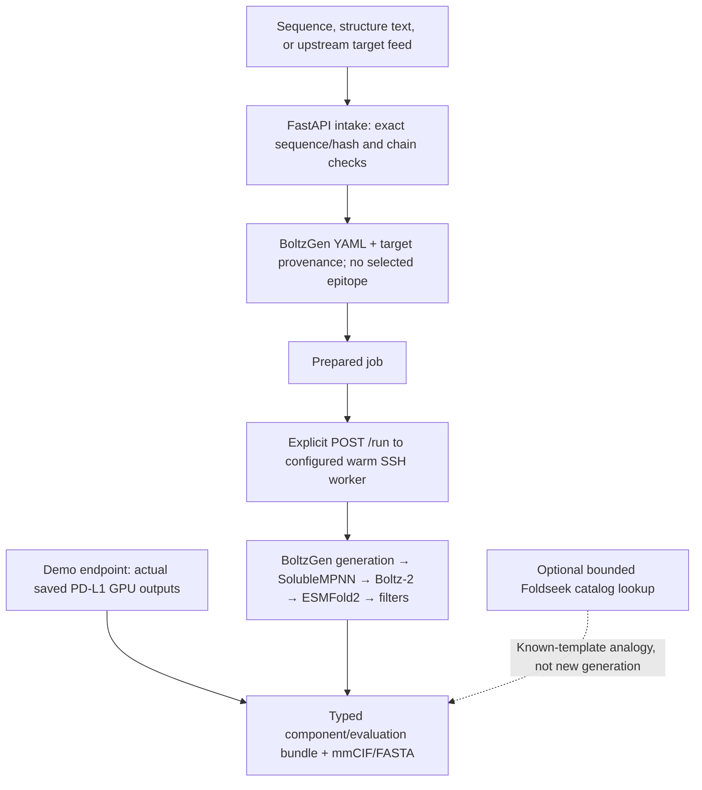

# Teammate integration: molecular design pipeline

Use the existing Python service; no new website is required. It accepts exact protein sequence, one structural chain, or the upstream translated-target response. New requests prepare a reproducible, epitope-unconstrained BoltzGen job. A separate demo endpoint returns actual saved GPU outputs immediately.

## Start locally

From the repository root:

```sh
uv sync --extra design --extra dev
.venv/bin/uvicorn biocad.service:app --host 127.0.0.1 --port 8000
```

Interactive API contract: `http://127.0.0.1:8000/docs`. Run files default to `outputs/service`; set `BIOCAD_RUNS_DIR` to change their location. This is a local integration service with no authentication layer: keep the loopback address for the demo.

## Three working requests

The JSON files are checked-in, synthetic integration fixtures derived from the observed PD-L1 chain in 5JDS. They are not patient records. Run these from the repository root:

```sh
# Instant replay of actual previously executed, no-epitope GPU designs.
curl -sS -X POST http://127.0.0.1:8000/v1/designs/demo \
  -H 'Content-Type: application/json' --data-binary @examples/design_api_requests/demo.json

# Prepare a NEW target from sequence. Inference remains pending.
curl -sS -X POST http://127.0.0.1:8000/v1/designs \
  -H 'Content-Type: application/json' --data-binary @examples/design_api_requests/sequence.json

# Prepare a NEW target from the existing translated-target feed without coordinates.
curl -sS -X POST http://127.0.0.1:8000/v1/designs/upstream \
  -H 'Content-Type: application/json' --data-binary @examples/design_api_requests/upstream_unresolved.json
```

For a structure instead, POST `/v1/designs` with `structure_text` containing the actual PDB/mmCIF text, `format` equal to `pdb`, `cif` or `mmcif`, and `chain` equal to its author chain ID. Supply exactly one of `sequence` and `structure_text`. Optional `binder_length` defaults to 75; `num_designs` defaults to 2. Both modes use no specific epitope/hotspot.

For upstream structured targets, `/v1/designs/upstream` accepts the original `TranslateResponse` fields plus `artifact_texts`, mapping declared relative structure filenames to their text, and optional `chain_selections`, mapping target IDs to author-chain lists. Unresolved structures retain the exact protein sequence and become sequence-input jobs. Sequence hashes must retain the upstream `sha256:` prefix. RNA expression stays RNA evidence; protein abundance is not inferred.

## Read the response and artifacts

Every response contains `run_id`, `status_url`, `artifact_base_url`, `cloud_launched` and `execution_performed`. Fetch the returned `status_url` to obtain the file list. Append a listed relative artifact path to `artifact_base_url` to download it.

- `prepared_pending_gpu_execution`: preparation succeeded; **no design inference has run**. The prepared folder contains target provenance, the no-epitope design YAML and the run plan.
- `cached_demo_completed`: the demo exported actual saved BoltzGen outputs from the completed PD-L1 GPU run. It did **not** generate fresh designs for this HTTP request.
- `failed_preparation` or failed intake: inspect the returned error or per-target `records`; do not display the target as successfully designed.

The cached demo returns a `bundle` path (`bundle/bundle.json`) with target-linked components, exact sequences/coordinates, evaluations and provenance. Its two candidates include one native-filter pass and one failure. Both had low interface confidence. Present the raw checks and their limitations: a computational filter pass is not measured binding, affinity or biological function.



## Execute a fresh prepared job

The service now exposes an explicit existing-worker route. Configure these environment variables **before starting the service**:

```sh
export BIOCAD_WORKER_HOST='your-worker-address'
export BIOCAD_WORKER_PORT='your-worker-ssh-port'
export BIOCAD_WORKER_KEY='/absolute/path/to/local/ssh-key'
```

The worker must already have the pinned BoltzGen environment and model cache installed. This route does not create a pod. After a successful preparation, substitute the returned run ID:

```sh
curl -sS -X POST http://127.0.0.1:8000/v1/designs/RUN_ID/run \
  -H 'Content-Type: application/json' --data '{}'
```

The endpoint returns 202, then the background worker uploads inputs, executes BoltzGen, downloads outputs and exports the component/evaluation bundle. Poll the returned status URL. For an upstream batch, send `{"target_index": 0}` to choose a prepared target. Live API jobs are bounded to 1–32 designs. Missing worker configuration returns 503; duplicate or non-ready runs return 409. A cached demo run is not eligible for fresh dispatch: prepare a new sequence/structure job first.

`cloud_launched=false` means the API did not provision a machine; a live run can still perform real inference on the configured existing GPU worker. Successful live status is `completed` with `mode=live_model_outputs`. Failures persist as `failed`; inspect the worker receipt/logs and any `remote_cleanup_required` flag. A timeout can leave remote execution running. The API does not stop or delete the pod, so lifecycle cleanup and the spending cap remain the operator/controller's responsibility.

A persistent Runpod model/cache volume reduces repeated downloads. It should contain model weights and runtime setup, while each run retains a separate job directory. New sequence-only inputs are accepted as sequence jobs; acceptance itself does not establish a validated target fold.

Verification: all three fixture requests were exercised using FastAPI `TestClient`; expected status, status inspection and artifact downloads succeeded without cloud resources. Worker orchestration tests mock SSH only and ingest actual saved native candidate files; successful export and failed/timeout partial downloads are tested. These local checks do not establish a fresh GPU execution through the new route; that must be verified against the configured worker.
