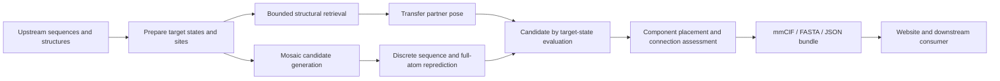

# Engineer integration

The scientific implementation is one Python package and CLI. The teammate-facing HTTP adapter is `biocad.service:app`; see the current hackathon handoff and punchlist. No database is required. Public entry points are `structures.prepare`, `structures.select_indices`, `retrieval.search`, `retrieval.transfer`, `mosaic_adapter.compile_request`, `mosaic_adapter.run`, and `pipeline.run_example`. Geometry and assembly logic is currently integrated into the demonstration, rather than a general-purpose assembly API.

`contracts.py` defines strict Pydantic objects. `examples/response.schema.json` is the generated JSON Schema. The exact example request/response is in `examples/replay/`. Recreate the schema with `biocad schema`.



## Request choices that affect computation

| Catalog choice | Current executable consequence |
|---|---|
| Site | Author residue IDs and insertion codes resolve to zero-based target-relative indices; these select Mosaic contact-loss columns |
| Binder size | Changes the design sequence dimension |
| Attachment N/C | Chooses terminal anchoring atoms and fusion direction |
| Terminal clearance | Changes geometry pass/fail; checked after generation |
| Module spacing and axis | Changes actual rigid coordinates and inter-component/context clashes |
| Linker sequence | Changes proposed FASTA and maximum contour estimate |
| Recognition mode / exclusions | Recorded; selective negative design unsupported in current runner |
| Scaffold/fixed regions | Experimental replay is immutable; scaffold-conditioned live optimization not implemented |
| Evidence requirement | Missing prediction remains missing; no confidence-based acceptance threshold is implemented |

Target-state, component revision, assembly and evaluation IDs are separate. The same component is evaluated against both supplied states. Original residue IDs and label sequence IDs remain available in mappings. Sequence hashes refer to the exported observed construct; full deposited entity sequences and unobserved rows are retained separately. Model-input indices are local to a chain; the live plan declares binder first and target second.

Transforms map source to destination using column vectors: `x_destination = R @ x_source + t`. NumPy batches use `x @ R.T + t`. Units are Å. Site/port frames map local coordinates into source structure coordinates. Three noncollinear anchors are needed; underdetermined frames are null. Reflections are rejected. Pose transfer refits aligned Cα positions instead of guessing Foldseek rotation direction.

Each required interface gets its own evaluation. `assessed` means geometry was measured, not binding or function passed. A severe clash is a heavy-atom pair below 1.5 Å. Contacts count pairs below 5 Å. These are broad triage rules, not a force field, SASA or binding energy. Waters/ligands in selected target chains are included as context. The entire original source is retained; other chains and biological-assembly expansion are not automatically included. The small-molecule-bound alternate can therefore legitimately reject a transferred pose.

The assembly's `target_placements` declares both target transforms; `instances` declares both component transforms. An explicit linker sequence and proposed fusion FASTA are exported, but coordinate chains remain separate. Reach below the contour bound is only a necessary condition. The HTML report shows three orthographic Cα views per structure; all-atom details remain in mmCIF.

## Calling and replay

```python
from biocad.pipeline import run_example
response = run_example('examples', 'outputs/my-run', foldseek='vendor/foldseek/bin/foldseek')
```

Use `biocad demo --request examples/replay/request.json --output outputs/custom` after editing spacing, attachment or clearance. Do not change the fixed fixture state IDs; general target import uses `prepare` directly. Output paths inside the bundle are relative; resolve them against its root. Progress is currently stage-level in the final response, not streaming callbacks.

Foldseek `createdb` and `easy-search` invocations are recorded in `retrieval.json`, with native tabular alignments and logs beneath `retrieval/`. The library is explicitly bounded to 1–100 files and top-K to 25. The example uses one declared target template: a plumbing test, not a retrieval benchmark. Ranking uses raw alignment TM score; query/target TM normalization and coverage are preserved, with E-values retained unmodified. Database input mmCIFs are in `library/`.

There is no affinity ranking. Candidates with missing evidence cannot be promoted by treating null as zero. Diversity retention, negative-panel prediction, whole-construct scoring, and model-to-response ingestion remain pending.

## Compact placement extension

`placement.run_search(bundle, output, PlacementSearchRequest(...))` and `biocad placements`
add a CPU-only packing screen. The request controls bounded offsets/rotations, linker,
attachment terminus, overlap tolerance and top-K. `placement_search.json` preserves all
sampled score vectors and rejected layouts. This route co-moves each observed target/key
pair, so it hypothesizes relative target placements rather than fitting fixed sites.
See [ASSEMBLY.md](ASSEMBLY.md). Install the combined repository with
`uv sync --extra design --extra dev --locked`; both `bespoke_bio` and `biocad` are packaged.

## Motif scaffolding preparation

`biocad motifs --assembly examples/compact_assembly --output outputs/motif-plan` exports
indexed-block model input drafts and a residue mapping. `motifs.prepare_plan` is the
callable API. `motifs.check_motif_geometry(plan_directory, candidate_mmCIF, topology_id)`
checks future outputs in the declared A/B/C chain contract; native chain names and
residue numbering must first be confirmed against the model's own mapping. Passing
this narrow check does not establish a folded connection or binding function.

## Active off-the-shelf binder pipeline

`biocad boltzgen-prepare --output <directory>` exports the single-target PD-L1 fixture,
canonical label-residue mapping, a complete entity-poly sequence table and the BoltzGen
specification. It pins upstream commit `a07fea1153111ef453aaea7a15697ee05de9291f`
(BoltzGen 0.3.2). The ordinary `protein-anything` protocol runs design → SolubleMPNN
inverse folding → binder-only and complex Boltz-2 prediction → ESMFold2 scoring → analysis
and filtering. Our adapter supplies inputs; upstream owns the scientific pipeline.

The smoke test uses two 75-residue candidates against the 115 observed PD-L1 residues
from 5JDS, with no specified epitope (BoltzGen chooses the binding site). Candidate count and final output
`--budget` are separate from the $100 cloud spending cap. Keep all metrics, filter flags,
failed candidates and original/refolded coordinates. An empty accepted set is a valid
scientific result, not a reason to silently loosen filters. The earlier RFD3/Mosaic/RF3
plans remain research components, not the active off-the-shelf execution route.
