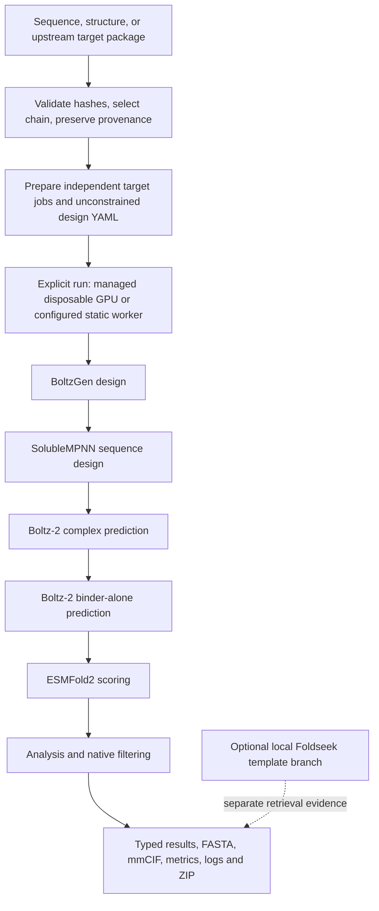

# Active pipeline and API integration

Run `biocad.service:app` for the combined translation/design API. The active model is
BoltzGen 0.3.2, pinned at `a07fea1153111ef453aaea7a15697ee05de9291f`.
The repository supplies validation, job orchestration and portable result export;
BoltzGen owns the scientific generation/prediction/filtering protocol.

No epitope or hotspot is selected. Sequence-only input uses the native sequence-conditioned
route; it does not acquire an independently validated target structure during local
preparation. Structure inputs preserve the original source and author-to-normalized residue
mapping. Candidate chains are identified by exact sequence, not presumed chain letters.

## HTTP boundary

| Route | Purpose |
|---|---|
| `POST /v1/translate` | Translate upstream CDS/variant inputs |
| `POST /v1/designs` | Prepare one sequence/structure target |
| `POST /v1/designs/upstream` | Import a proposed upstream package and create child jobs |
| `POST /v1/designs/{id}/run` | Explicitly queue a prepared job; managed mode provisions a disposable GPU |
| `POST /v1/designs/{id}/cancel` | Cancel a managed job and request owned GPU cleanup |
| `GET /v1/service` | Read managed readiness, phase budget and expiry |
| `GET /v1/designs/{id}` | Inspect status, native-stage progress and artifacts |
| `GET /v1/designs/{id}/results` | Read typed candidate results; upstream parents return a child index |
| `GET /v1/designs/{id}/download` | Download that run's ZIP |
| `GET /v1/designs/{id}/artifacts/{path}` | Download one contained artifact |
| `POST /v1/designs/demo` | Replay the actual saved two-candidate PD-L1 result |

Binder length is 25–300 residues, default 75. Candidate count defaults to 2; live jobs
are limited to 1–32 designs. The model's final candidate budget is not a dollar budget.
Shared managed mode (`BIOCAD_MANAGED_WORKERS=1`) requires bearer authentication, persists
its queue/budget in SQLite, provisions a GPU per job and deletes it after collection.
It reserves $10 per job against the $100 phase cap, with $13 held for prior/service costs.
Jobs are bounded to two hours at at most $4/hour; the gateway expires after 24 hours.
CPU state storage is separate from the GPU model cache; cloud credentials and executable
controller code stay on CPU-local disk. See [deployment](SHARED_SERVICE.md).
Static mode uses an existing worker configured with `BIOCAD_WORKER_HOST`,
`BIOCAD_WORKER_PORT` and `BIOCAD_WORKER_KEY`.

Jobs move from `prepared_pending_gpu_execution` through `queued` and `running` to
`completed` or `failed`. No worker returns 503; pending candidate results return 409.
Duplicate dispatch is rejected. Each upstream target has its own child run and outputs.
Execution is serial. Managed mode uses durable claims and conservative spend reservations,
cleans recorded owned GPUs on restart, and marks interrupted jobs without silently rerunning
them. It is a single-controller queue, not a distributed scheduler.
Managed cancellation/deadlines trigger GPU deletion and report unconfirmed cleanup; the
queue refuses further work while a recorded GPU remains active. Static-worker timeouts
may leave remote inference running and require operator cleanup.

## Data and evidence

The Python entry point `biocad.client.DesignClient` and CLI `biocad submit-bundle` embed
only declared, contained structure files from a `targets.jsonl`/`provenance.json` package.
RNA expression and variant records remain provenance; they do not alter the binder objective.
See [the proposed feed contract](FEED_CONTRACT.md) and [HTTP walkthrough](HACKATHON_HANDOFF.md).

Results separate native filter outcomes, confidence metrics and measured binding evidence.
The portable `DesignBundle` contains target states, stable component IDs, evaluations,
sequence hashes, structures and provenance. Attachment frames and terminal point-clearance
measurements support future component use; they do not establish a connected assembly.
Missing/nonfinite metrics remain null. Failed candidates are retained; ranking is not acceptance.

`examples/design_api_requests/openapi.json` describes the HTTP interface. The older
`examples/response.schema.json` describes the experimental CAD/replay contracts and is not
the active API schema. Mosaic, motif redesign and rigid assemblies are documented under
[history](LEGACY.md).
