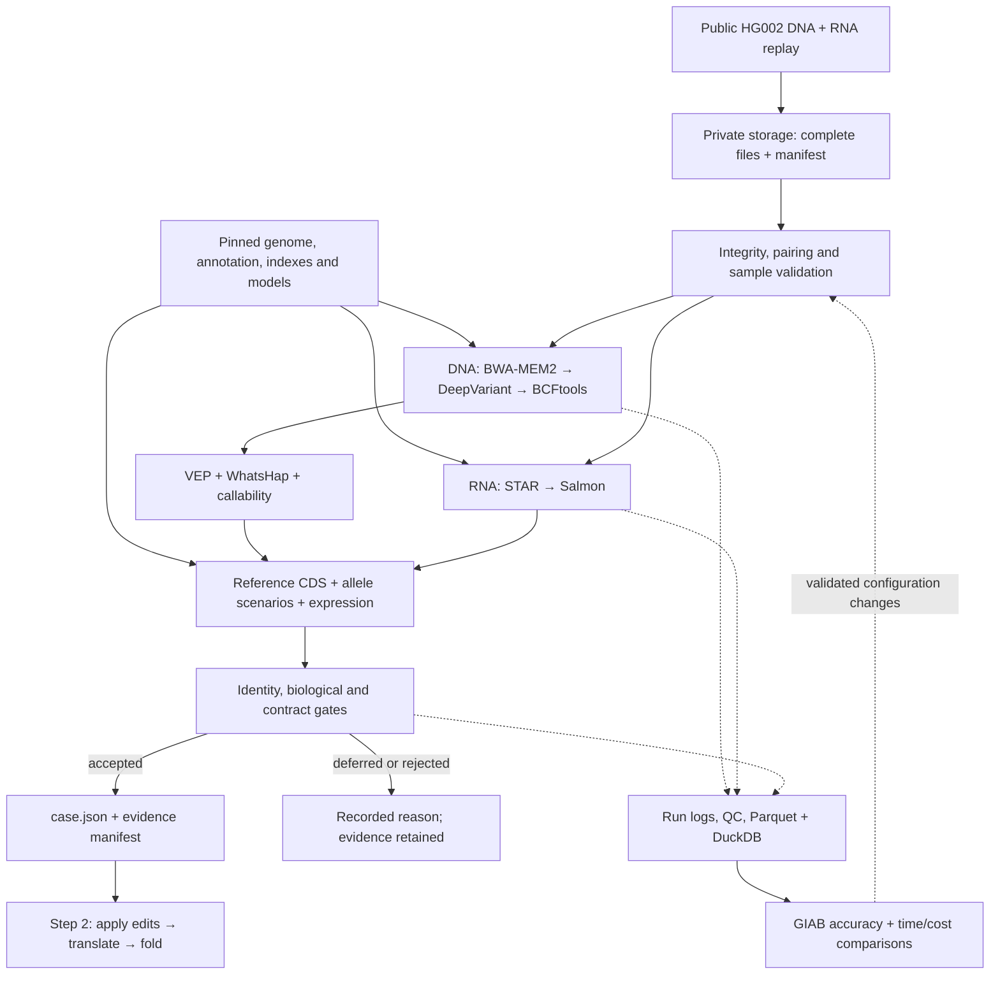

# Stage 1: human reads to the Step 2 handoff

Convert paired-end Illumina germline WGS DNA and bulk RNA into reference CDS, CDS-relative
variants, expression and explicit phase scenarios. Step 2 applies the variants, translates
and folds using the [handoff contract](architecture.md#step-1---step-2) and
[API models](../src/bespoke_bio/api.py).

Initial scope: small variants and existing autosomal, standard-code protein-coding transcripts.
Align against the full selected human reference and retain unsupported evidence with a reason.
Optimize **time and cost per validated case**, starting with one case and one CPU worker.

## 1. Inputs and references

| Resource | Starting source and decision |
| --- | --- |
| DNA reads | [GIAB HG002 Illumina 2×150 WGS index](https://ftp-trace.ncbi.nlm.nih.gov/ReferenceSamples/giab/data_indexes/AshkenazimTrio/sequence.index.AJtrio_Illumina300X_wgs_07292015_updated.HG002). Select and record paired files from this approximately 300× collection to derive a reproducible approximately 30× subset. Measure achieved coverage. |
| RNA reads | [GIAB HG002 Google Illumina mRNA reads](https://ftp-trace.ncbi.nlm.nih.gov/ReferenceSamples/giab/data_RNAseq/AshkenazimTrio/HG002_NA24385_son/Google_Illumina/mRNA/reads/): `hg002_gm24631.mrna.R1.fastq.gz`, matching `R2`, and `md5.in`. Retain the [library README](https://ftp-trace.ncbi.nlm.nih.gov/ReferenceSamples/giab/data_RNAseq/AshkenazimTrio/HG002_NA24385_son/Google_Illumina/README_RNAseq_Google_HG002-Ill.md); verify strandedness and record aliquot/passage separately from donor identity. |
| Genome and annotation | [GENCODE 50 files](https://ftp.ebi.ac.uk/pub/databases/gencode/Gencode_human/release_50/): `GRCh38.primary_assembly.genome.fa.gz`, `gencode.v50.primary_assembly.annotation.gtf.gz`, protein translations, and `MD5SUMS`. GENCODE 50 corresponds to Ensembl 116; primary assembly excludes alternate/patch sequences present in the broader bundle. |
| Variant truth | [HG002 v5.0q](https://ftp-trace.ncbi.nlm.nih.gov/ReferenceSamples/giab/release/AshkenazimTrio/HG002_NA24385_son/v5.0q/): `HG002_GRCh38_v5.0q_smvar.vcf.gz`, its index, matching `smvar.benchmark.bed`, README, and checksums. NIST now [supersedes HG002 v4.2.1](https://www.nist.gov/programs-projects/genome-bottle) with this draft benchmark. Keep truth separate from processing inputs. |

Lock URLs, checksums, sizes, donor/specimen/library/lane IDs, assay, protocol, read length,
and derivation commands/seeds. Verify source checksums after transfer; compute SHA-256 at
immutable registration. Use published FASTQs and native sampling that preserves pairs.

Bundle FASTA/`.fai`, per-contig MD5 dictionary, GTF, versioned transcript/CDS/protein records,
and indexes. Derive transcripts within the same assembly scope; validate exon order, strand,
CDS phase and translation against GENCODE proteins. Include the annotated terminal stop in
the handoff CDS. Check benchmark contigs/reference sequences; masked GRCh38 is a different
asset. Never silently strip versions or rename contigs to force a join.

MANE prioritizes transcripts; retain other isoforms. Optional gnomAD enrichment uses indexed
local sites files with artifact version, population, allele number and missingness.
[gnomAD 4.1.2](https://gnomad.broadinstitute.org/news/2026-09-gnomad-v4-1-2/) updates constraints
only; frequency data remain those of 4.1.1. Preserve common coding alleles.

## 2. Tools

Run Linux x86-64 containers on the worker. Use Python/Pydantic for the small adapter and
native libraries for indexed I/O; keep per-read processing inside established engines.
Stage 1 needs no GPU, hosted analysis API, database server or workflow control service.

| Work | Baseline | Main implementation / license |
| --- | --- | --- |
| Scheduling, resources, retries, resume | [Nextflow **26.10.2**](https://github.com/nextflow-io/nextflow/releases/tag/v26.10.2), Docker Engine; [sarek **3.10.0**](https://github.com/nf-core/sarek/tree/3.10.0), [rnaseq **3.27.0**](https://github.com/nf-core/rnaseq/tree/3.27.0) | Nextflow Apache-2.0; workflows MIT |
| Intake/QC | Workflow FastQC, fastp where configured, MultiQC; explicit RNA adapter trimming policy | Java/C++/Python; GPL-3.0, MIT, GPL-3.0 respectively |
| DNA mapping and preparation | Sarek BWA-MEM2 **2.3**, SAMtools/HTSlib, caller-appropriate duplicate handling | C/C++; MIT/BSD components |
| Germline SNVs/short indels | Sarek DeepVariant **1.10.0**, WGS model; retain VCF **and gVCF** | Native/model computation; BSD-3-Clause |
| Normalize, index, coverage | BCFtools, SAMtools, workflow mosdepth; preserve original calls | C/Nim; BCFtools MIT or GPL depending on build; mosdepth MIT |
| Consequences | Offline Ensembl VEP **116.0**, matching **116** cache and pinned FASTA | Perl/native dependencies; Apache-2.0 |
| RNA evidence | rnaseq STAR **2.7.11b** + Salmon **2.7.0**, `star_salmon` route | C++ / Rust; MIT / BSD-3-Clause |
| Read-backed phase | [WhatsHap **2.8**](https://whatshap.readthedocs.io/en/stable/guide.html), including indels | Python/C++; MIT |
| Reference CDS extraction | [gffread **0.12.9**](https://github.com/gpertea/gffread), indexed PySAM reads and a small coordinate adapter | C++ / HTSlib-backed Python; MIT |
| Identity and accuracy checks | [Picard CrosscheckFingerprints](https://broadinstitute.github.io/picard/command-line-overview.html#CrosscheckFingerprints); [hap.py](https://github.com/Illumina/hap.py) with RTG vcfeval | Java / C++/Python/Java; MIT / BSD licenses |
| Derived evidence queries | Parquet + embedded DuckDB | Native engine; DuckDB MIT |

Both workflow tags require Nextflow ≥25.10.4. Lock commits,
public source URLs, container digests, models, databases and dependency licenses in
`config/stage1.lock.json`. Keep resolved runtime configs with private run artifacts.
Retain workflow-pinned dependencies and cache all run assets locally.

rnaseq 3.27.0 already pins Salmon 2.7.0. Newer releases—[Salmon 2.8.0](https://github.com/COMBINE-lab/salmon/releases/tag/v2.8.0),
[VEP 116.3](https://github.com/Ensembl/ensembl-vep/releases/tag/release/116.3),
[SAMtools](https://github.com/samtools/samtools/releases/tag/1.24)/[BCFtools 1.24](https://github.com/samtools/bcftools/releases/tag/1.24)—need upgrade benchmarks.
Include a project `LICENSE` and record code/model/data licenses and redistribution terms,
including GPL dependencies and vendor terms for optional CUDA acceleration.

Sarek's [VEP defaults](https://nf-co.re/sarek/3.10.0/parameters)
include `--filter_common --per_gene`. Remove both, retain all transcript consequences,
request versioned transcript IDs and reference checks, and reconcile annotated records
against original calls. Restrict optional VEP plugins to the resources actually locked.

Use BWA-MEM2 for read mapping; reserve protein homology/MSA search for Step 2. Benchmark
[minibwa](https://github.com/lh3/minibwa), [fastVEP](https://github.com/Huang-lab/fastVEP) or
elPrep only at measured bottlenecks, checking reference support, biological differences and
memory cost.

## 3. Processing and validation

1. **Receive.** Replay complete FASTQ pairs, uploading the input manifest last. Poll for
   manifests initially; later queues carry object references. Deduplicate by input/reference/
   config hashes. Sensor metadata accompanies files; raw-signal basecalling is outside scope.
2. **Validate intake.** Check hashes, decompression, FASTQ structure, sequence/quality lengths,
   read-pair names/counts/order, sample metadata, and supported assay. Preserve `N` and raw
   reads; reject malformed data. Use native parsers and combine scans where practical.
3. **Run branches.** DNA: map → sort/index → duplicate handling → DeepVariant VCF/gVCF →
   normalization. Use model-appropriate preprocessing, reviewing BQSR/trimming. RNA:
   QC/adapter handling → STAR → Salmon; retain genomic/splice evidence and native outputs.
   Check mapping, duplication, coverage, contamination indicators, strandedness/rRNA and
   fingerprints. Mismatched or inconclusive sample identity blocks release.
4. **Annotate and phase.** Preserve assembly-qualified variant IDs, QUAL, FILTER, DP, GQ,
   allele depths, genotype, PS and original-to-normalized allele links. Test multiallelic genotype/AD/PL remapping. WhatsHap
   supplies supported phase blocks; never connect independent PS blocks or label a haplotype
   maternal/paternal without evidence. RNA abundance is transcript-total, not allele-specific.
5. **Resolve CDS.** Project variants through the exon map in coding orientation: VCF/CDS
   positions are 1-based; BED is 0-based half-open. Reverse-complement negative-strand
   alleles and retain valid indel anchors. VEP consequence/position alone is insufficient.
   Normalize adapter sequences to uppercase DNA (`U` → `T`); require unambiguous `ACGT`
   for released CDS. Reject REF mismatches, overlaps and unsupported boundary edits.
6. **Gate targets.** Require PASS calls and confident genotypes across the entire CDS;
   missing VCF records are not reference evidence. Configure replay thresholds for depth ≥10
   and GQ ≥20 throughout, using gVCF plus conservative coverage evidence. Record uncertainty.
   Defer unresolved splicing, partial CDS, selenoproteins and
   frameshift/start-loss/stop-loss cases needing sequence beyond the supplied CDS.
7. **Publish.** Validate payload, counts, hashes and index access; publish outputs, then the
   ready manifest. Failures cannot publish readiness. Account for every accepted/deferred/
   rejected candidate. An empty selection is recorded but cannot be sent to Step 2.

[SAMtools quickcheck](https://www.htslib.org/doc/samtools-quickcheck.html) skips file interiors;
also require full native decoding, sort/index checks and read-count reconciliation. Expression
must be finite/nonnegative; retain fractional Salmon counts.

## 4. Step 2 handoff and formats

Produce **`case.json`, `manifest.json` and indexed evidence**. Only `case.json` goes to
`POST /v1/build?folding_backend=...`, which runs the full Step 2 pipeline and rejects unknown
input fields. Companion evidence records schema/contract identity, reference hashes, genomic
coordinates, callability, sample identities, QUAL/GQ/DP, expression semantics, tool versions
and unsigned artifact URIs.

The manifest requires `schema_version`, `run_id`, `case_id`, `case_sha256`, reference/config
hashes, artifact roles/locations/sizes/hashes, validation results and disposition counts.
Validate it before submission. Link the input hash and manifest to the returned Step 2
`bundle_id` in the run catalog; the API accepts the case payload alone.

Each transcript contains **unmodified reference CDS**, versioned gene/transcript IDs,
expression and edits for one explicit haplotype/scenario. Step 2 applies edits once, in
original CDS coordinates. Map `quality` to FILTER and `raw_count` to Salmon's fractional
estimate, documenting those semantics. API schema validation does not verify GENCODE identity.

Emit both supported alleles, including a no-edit reference scenario when warranted. One
unphased heterozygous site produces two unordered scenarios; multiple unresolved sites/blocks
defer the transcript. Never combine all ALTs or invent phase. Retain common and rare alleles.

Use a configurable integration-test batch of up to **10** callable, complete autosomal
transcripts with `TPM > 0`, preferring MANE and variant-bearing examples deterministically.
Preserve all evidence and exclusion reasons. Step 2 folds every supplied unique protein.

Step 2 searches external RCSB/AlphaFold services; Boltz also requires an MSA service.
An entirely local deployment needs a separate Step 2 lookup/MSA policy. Translation preflight
uses `translate_case` locally without invoking structure lookup or folding.

| Artifact | Format |
| --- | --- |
| Received reads | Original paired `FASTQ.gz` |
| Active alignment / archive | Sorted indexed BAM / lossless CRAM + CRAI + exact FASTA |
| Variants and reference confidence | Native gVCF; BCF where compatible; BGZF VCF + CSI/TBI for interchange |
| Coverage/callability, annotation | BED with coordinate convention; native VEP output |
| RNA | Genomic BAM, splice junctions, Salmon `quant.sf` and metadata |
| Derived evidence and run catalog | Typed Parquet, queried with DuckDB; retain nulls and source IDs |
| Handoff and readiness | Existing-schema `case.json`; versioned `manifest.json`, QC and provenance |

## 5. Storage and performance

**Start with one worker: 32 vCPU, 256 GiB RAM, approximately 1.2 TiB fast local SSD scratch,**
Ubuntu 24.04 x86-64 and Docker Engine. Use a persistent SSD for Nextflow work/cache;
2 TiB is a starting allocation, subject to a full input/index/intermediate space budget.
Stage 1 tools run as jobs on this worker. DuckDB runs inside the adapter/reporting process.
Compare a 16-vCPU/128-GiB worker and faster NVMe before increasing spend; GPU DeepVariant
inference is an optional benchmark that must include CPU preparation and transfer time.

Keep private object-storage areas for `inputs`, `references`, `runs` and `benchmarks` (truth).
Address immutable assets by hash/release and runs by ID. Fetch public data directly on the
worker, stage it once, and keep compute/storage close. Use local or persistent SSD paths for
sorting and random access. Object storage holds durable inputs, references and final evidence.

Retain Nextflow metadata **and** required work outputs on persistent storage for resume.
Local scratch is disposable. Before launching, check free space and configured disk throughput;
stop new tasks before space exhaustion. Keep originals/final evidence through pilot review;
delete temporary work only after hash verification, restore testing and explicit retention
expiry. Set run timeouts and idle shutdown; account for storage costs after compute stops.

Performance rules:

- Prebuild indexes once; reuse a local read-only bundle keyed by content and tool version.
- Give concurrent DNA/RNA launches separate budgets totaling at most **30 CPUs / 240 GiB**
  on the 32-core node. Separate Nextflow launches do not coordinate their resource limits.
  Count aligner, sorter and compression threads together; SAMtools sort memory is per thread.
- Use workflow-supported lane/interval scattering and correct gather steps. Stage once per
  worker, bound concurrency by RAM and scratch, and retry transient failures only.
- Keep FASTQ compressed; use supported pipes and BCF streams between adjacent tools.
  Avoid repeated gzip/text conversions and per-transcript genome scans; retain required
  sort/index outputs and durable checkpoints. Add shared memory or custom zero-copy code
  only when profiling identifies an avoidable copy as a significant bottleneck.
- Query indexed native files and selected Parquet columns/partitions with DuckDB.

## 6. Telemetry and operations

Retain Nextflow `-with-trace`, `-with-report`, `-with-timeline`, logs/stdout/stderr/exit codes,
resolved config, versions and MultiQC per attempt. Adapter JSONL events contain UTC time,
run/task/attempt ID, stage, status, duration and error category. Query Parquet run/QC tables
with DuckDB. [Nextflow reports](https://docs.seqera.io/nextflow/reports).

Measure transfer bytes/time, queue/runtime, CPU, peak RAM, disk I/O/scratch, retries/cache
hits, biological QC, phase/callability, target disposition and variant accuracy. Supplement
traces with host `pidstat`/`iostat`/disk sampling. Separate cold setup, warm processing and
resume timings; include VM/disk/storage/transfer/retry costs.

**Defer OpenTelemetry.** For distributed API/queue tracing, add OTel + Collector; use
Prometheus/node exporter + Grafana for live metrics, Loki/Tempo if central logs/traces are
needed. Label metrics by stage/tool/status; keep IDs/hashes
in private logs and sequences out of traces. [OTel scope](https://opentelemetry.io/docs/what-is-opentelemetry/).

Operate workers through local SSH; keep provisioning, addresses, identities and runtime
configuration outside the checkout. Commit portable workflows and CI; keep deployment local.

- PR CI runs Ruff, pytest, contract/fixture tests and secret scanning on GitHub-hosted runners,
  without worker/storage access. Pin Actions by commit SHA; run reviewed commits on workers.
  Never execute fork code on an identity-bearing worker or use privileged PR execution.
- Restrict SSH ingress to an approved source IP or private network, use keys and verify host
  keys. Bind APIs to loopback and use SSH tunnels; the Step 2 API has no authentication.
  Keep Docker private. Run workflows under a service/session that survives SSH disconnects.
- Use scoped worker identity for storage access. Keep credentials, provider configuration,
  provisioning/state files, generated data and runtime logs outside Git. Public source locks
  contain public dataset URLs; private artifact locations belong in runtime manifests.
- Scan staged changes/history with Gitleaks. Redact authenticated URLs and environment dumps;
  publish only reviewed public-fixture reports. Keep local command history and CLI token
  caches out of captured logs and CI artifacts.

## 7. Layout and implementation order

```text
config/stage1.lock.json          # public sources, tools, models, licenses and hashes
config/stage1.yaml               # portable resource defaults, QC policy, target limit
workflows/stage1/                # pinned upstream launch configs; adapter tasks
src/bespoke_bio/stage1/          # intake, references, evidence, cds, handoff, cli
tests/stage1/                   # contract, biology, failure and replay tests
tests/fixtures/stage1/           # tiny public/synthetic fixtures + provenance
.github/workflows/              # unprivileged CI only
```

Use small typed functions, explicit subprocess arguments and bounded native I/O. Separate
scheduling from biology. Reuse Step 2 models, with independent expected sequences for tests.
Keep Stage 1 out of `api.py`; configure upstream workflows rather than forking them.

1. **Lock and contract:** freeze files, reference compatibility, containers/licenses,
   companion schema and Step 2 contract tests.
2. **Intake replay:** test interrupted transfer, wrong hash, broken FASTQ/pairs, duplicate
   arrival, wrong donor/reference, corrupted cached output, failed pipe and atomic publication.
3. **Smoke:** run upstream `test,docker`, then bounded human data against the full reference.
   Exercise the actual DeepVariant/VEP and STAR/Salmon configuration.
4. **Full case:** run approximately 30× HG002 DNA + selected RNA. Use v5.0q's hap.py/vcfeval
   instructions, sex/ploidy settings and GIAB v3.6 stratifications. Report SNP/indel precision,
   recall/F1, assessed regions, RNA QC, identity and phase completeness.
5. **Handoff:** independently verify every released reference/alternate sequence. Test
   schema/hashes, negative strands, exon boundaries, indels, multiallelic sites, common
   alleles, unphased combinations, missing coverage, fractional
   counts and terminal stops. Preflight locally with `TranslateRequest.model_validate`
   and `translate_case`; `/v1/build` also executes folding, which belongs to Step 2.
6. **Optimize:** repeat baseline runs; change one tool/resource setting at a time. Define
   accuracy/regression gates, latency targets and cost ceiling before promoting alternatives.
   Investigate disagreements, audit training overlap and add another donor before generalizing.

Before the full run, freeze these run-specific decisions:

| Decision | Required record |
| --- | --- |
| Input selection | Exact DNA pairs, sizes/checksums, sampling method/seed, RNA library metadata |
| Acceptance | Identity/QC cutoffs, CDS callability rules, SNP/indel precision/recall floors, target selection and reasons for deferral |
| Capacity and cost | Storage/free-space budget, task CPU/RAM limits, run timeout, maximum spend and retention/resume window |
| Reproducibility | Container/model/data locks, license inventory, manifest schema, reference/CDS checks and Step 2 contract identity |

Record baseline measurements before setting speed targets; faster alternatives must satisfy
the same accuracy gates. An upstream test profile or a small fixture cannot establish WGS
accuracy, capacity or cost.


