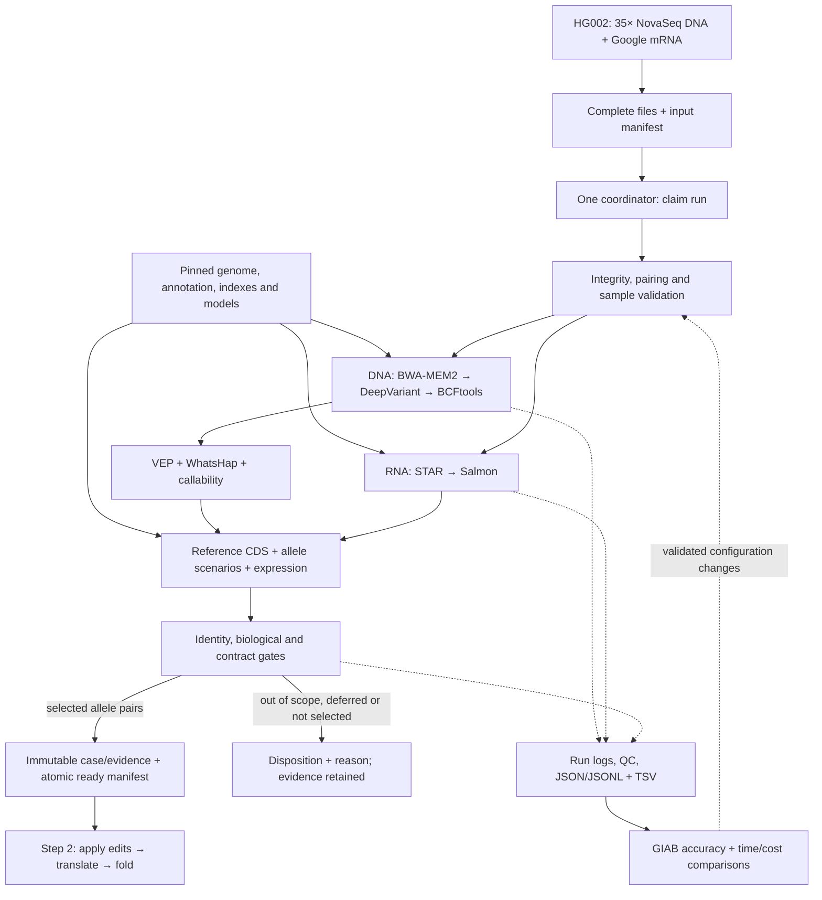

# Stage 1: human reads to the Step 2 handoff

Convert paired-end Illumina germline WGS DNA and bulk RNA into reference CDS, CDS-relative
variants, expression and explicit phase scenarios. Step 2 applies the variants, translates
and folds using the [handoff contract](architecture.md#step-1---step-2) and
[API models](../src/bespoke_bio/api.py).

Initial scope: diploid small variants and primary-GTF transcripts with
`transcript_type=protein_coding` on `chr1`–`chr22`, using the standard genetic code.
Predictions assume the annotated exon model. Bulk RNA does not prove full-length isoform
identity, allele expression or protein abundance. CNV, structural variation and mosaicism
are outside this pilot's model, not established as absent.
Align against the full selected reference and retain exclusions with reasons.
Optimize **time and cost per validated case**, starting with one case, one coordinator and
one CPU worker. Use the pinned workflows, thin adapters, native files and retained logs.

## 1. Inputs and references

| Resource | Starting source and decision |
| --- | --- |
| DNA reads | [NIST precisionFDA Truth Challenge V2](https://data.nist.gov/od/id/mds2-2336): **`HG002.novaseq.pcr-free.35x.R1.fastq.gz`** and matching `R2`. Use the supplied approximately 35× PCR-free WGS pair unchanged. Two files and published SHA-256 checksums simplify intake and avoid custom downsampling. |
| RNA reads | [HG002 Google Illumina mRNA directory](https://ftp-trace.ncbi.nlm.nih.gov/ReferenceSamples/giab/data_RNAseq/AshkenazimTrio/HG002_NA24385_son/Google_Illumina/mRNA/reads/): **`hg002_gm24385.mrna.R1.fastq.gz`** and matching `R2`. Use the directory's `md5.in`; the [README](https://ftp-trace.ncbi.nlm.nih.gov/ReferenceSamples/giab/data_RNAseq/AshkenazimTrio/HG002_NA24385_son/Google_Illumina/README_RNAseq_Google_HG002-Ill.md) contains stale `gm24631` filenames. This is poly-A-selected bulk RNA, 2×150. Keep aliquot/passage separate from donor identity. |
| Genome and annotation | [GENCODE 50 files](https://ftp.ebi.ac.uk/pub/databases/gencode/Gencode_human/release_50/): `GRCh38.primary_assembly.genome.fa.gz`, `gencode.v50.primary_assembly.annotation.gtf.gz`, protein translations, and `MD5SUMS`. GENCODE 50 corresponds to Ensembl 116; primary assembly excludes alternate/patch sequences present in the broader bundle. |
| Variant truth | [HG002 v5.0q](https://ftp-trace.ncbi.nlm.nih.gov/ReferenceSamples/giab/release/AshkenazimTrio/HG002_NA24385_son/v5.0q/): `HG002_GRCh38_v5.0q_smvar.vcf.gz`, its index, matching `smvar.benchmark.bed`, README, and checksums. NIST now [supersedes HG002 v4.2.1](https://www.nist.gov/programs-projects/genome-bottle) with this draft benchmark. Keep truth separate from processing inputs. |

Pin these DNA files from NIST's public mirror using the [catalog metadata](https://data.nist.gov/rmm/records/ark:/88434/mds2-2336):

| Mate | Compressed bytes | SHA-256 |
| --- | ---: | --- |
| [R1](https://nist-midas.s3.amazonaws.com/pdrsrv/mds2-2336/input_fastqs/HG002.novaseq.pcr-free.35x.R1.fastq.gz) | 29,911,262,422 | `0b8578457bd4f0a0503b5f3cbafff58da84ea32cc07c7caa3c553f152ac0686e` |
| [R2](https://nist-midas.s3.amazonaws.com/pdrsrv/mds2-2336/input_fastqs/HG002.novaseq.pcr-free.35x.R2.fastq.gz) | 31,043,207,981 | `726b987b13e05c245d373a2dc6cad64b6104bd756e6ed60e6b9052b72e0965c0` |

The DNA pair totals approximately **61 GB**. Measure read counts and mapped coverage;
nominal 35× does not guarantee coverage at every position. The pilot uses one DNA library
and one RNA library from the same donor; preserve separate specimen, passage and library
identities, with unknown metadata recorded as null. Do not pool replicates implicitly.
Map Sarek `patient` to donor, `sample` to DNA specimen, `status` to `0`, and record sex (`XY`
for HG002). Map rnaseq `sample` to RNA library. Record lane/delivery-unit IDs and generated
BAM `SM/LB/ID` read groups explicitly; a delivery ID does not establish an original lane.
Allow a download mirror only for the same pinned file and checksum, and record the URL used.
A checksum mismatch stops intake; never substitute another dataset automatically.

RNA source MD5s are `96a10e4f029805253ada8531c6ef87e9` (R1) and
`9df3298a1c919b064762bafe1963a271` (R2); sizes are 7,321,569,102 and 7,375,938,930 bytes.
Use the complete RNA library for the baseline. Record protocol and specimen IDs. For small
smoke subsets, lock the read count and seqtk seed, use matching mate seeds/order, and retain
derivation commands and hashes. Verify source checksums after transfer; compute SHA-256
when registering immutable inputs.

Bundle FASTA/`.fai`, per-contig MD5 dictionary, GTF, versioned transcript/CDS/protein records,
and indexes. Derive the full primary-assembly transcriptome, including noncoding transcripts,
for RNA; subset GENCODE proteins by GTF ID and verify every in-scope complete reference CDS.
Use the GTF's versioned transcript-to-gene mapping, not symbols or VEP gene IDs, for joins.
Validate exon order, strand, CDS phase and reference translation; include annotated stop bases
exactly once. gffread can already include them. Never trim phase bases from each internal exon.
Keep completeness tags (`cds_start_NF`, `cds_end_NF`), selenoprotein annotations and `MANE_Select`.
Check contig sequences against every asset; masked GRCh38 is different. Never silently strip
versions or rename contigs. Verify RNA preparation preserves expected IDs and sequences.
[GENCODE format](https://www.gencodegenes.org/pages/data_format.html),
[tags](https://www.gencodegenes.org/pages/tags.html).

Preserve common coding alleles and alternative isoforms. Defer optional population-frequency
enrichment until needed; it must not filter alleles needed for reconstruction.

## 2. Tools

Run Linux x86-64 containers on the worker. Use Python/Pydantic for the small adapter and
native libraries for indexed I/O; keep per-read processing inside established engines.
Stage 1 needs no GPU, hosted analysis API, database server or workflow control service.

| Work | Baseline | Main implementation / license |
| --- | --- | --- |
| Scheduling, resources, retries, resume | [Nextflow **26.10.2**](https://github.com/nextflow-io/nextflow/releases/tag/v26.10.2), Docker Engine; [sarek **3.10.0**](https://github.com/nf-core/sarek/tree/3.10.0), [rnaseq **3.27.0**](https://github.com/nf-core/rnaseq/tree/3.27.0) | Nextflow Apache-2.0; workflows MIT |
| Intake/QC | Workflow FastQC and MultiQC | Java/Python; GPL-3.0 |
| RNA adapter handling | Workflow [Trim Galore **2.3.0**](https://github.com/nf-core/rnaseq/blob/3.27.0/modules/nf-core/trimgalore/environment.yml) | GPL-3.0; retain dependency licenses |
| Reproducible fixture sampling | [seqtk **1.5**](https://github.com/lh3/seqtk/tree/v1.5), matching mate seeds/order | C; MIT |
| DNA mapping and preparation | Sarek BWA-MEM2 **2.3**, SAMtools/HTSlib and GATK duplicate marking; retain marked reads | C/C++/Java; MIT/BSD/Apache-2.0 components |
| Germline SNVs/short indels | Sarek DeepVariant **1.10.0**, WGS model; retain VCF **and gVCF** | Native/model computation; BSD-3-Clause |
| Normalize, index, coverage | BCFtools, SAMtools depth for CDS callability, workflow mosdepth for summary QC | C/Nim; BCFtools MIT or GPL depending on build; mosdepth MIT |
| Consequences | Offline Ensembl VEP **116.0**, matching **116** cache and pinned FASTA | Perl/native dependencies; Apache-2.0 |
| RNA evidence | rnaseq STAR **2.7.11b** + Salmon **2.7.0**, `star_salmon` route | C++ / Rust; MIT / BSD-3-Clause |
| Read-backed phase | [WhatsHap **2.8**](https://whatshap.readthedocs.io/en/stable/guide.html), including indels | Python/C++; MIT |
| Reference CDS extraction | [gffread **0.12.9**](https://github.com/gpertea/gffread), indexed PySAM reads and a small coordinate adapter | C++ / HTSlib-backed Python; MIT |
| Identity and accuracy checks | [Picard **3.5.0** CrosscheckFingerprints](https://github.com/broadinstitute/picard/blob/3.5.0/src/main/java/picard/fingerprint/CrosscheckFingerprints.java); [hap.py](https://github.com/Illumina/hap.py) with RTG vcfeval | Java / C++/Python/Java; MIT / BSD licenses |

Use native tool outputs, JSON manifests, JSONL events and small TSV reports for the pilot.
Defer Parquet and DuckDB until repeated queries across runs justify them; they are optional
reporting tools, not dependencies of the biological pipeline. Keep full callsets in indexed
native formats instead of building another database or copying them into JSON.

Both workflow tags require Nextflow ≥25.10.4. Lock workflow commits, Java/Nextflow/plugins,
public source URLs, container digests, models, databases and dependency licenses in
`config/stage1.lock.json`. Lock dependencies by task: rnaseq's gffread **0.12.7** and standalone
CDS extraction **0.12.9**, for example, are separate roles. Supply pipeline parameters
through `-params-file`, and executor/module settings through `-c`; save resolved values privately.
Preload assets and plugins, disable unpinned remote configuration imports, and verify an
[offline Stage 1 run](https://nf-co.re/docs/usage/getting_started/offline) with `NXF_OFFLINE=true`.
Missing required settings or assets stop preflight.

For both workflows, set `igenomes_ignore: true` and supply the pinned FASTA/index paths
explicitly; RNA also needs the matching GTF/transcript FASTA. Use the local Ensembl cache
with `vep_species: homo_sapiens`, `vep_genome: GRCh38`, `vep_cache_version: "116"` and
`vep_include_fasta: true`. Do not inherit Sarek's default reference/cache locations.

Baseline Sarek parameters: `tools: deepvariant,vep`, `aligner: bwa-mem2`, `wes: false`,
`trim_fastq: false`, `split_fastq: 0`, `skip_tools: baserecalibrator`,
`normalize_vcfs: true` and `filter_vcfs: false`. Keep duplicate marking/metrics and native
alignment outputs. Override `VCFS_NORM` arguments with `--check-ref e --old-rec-tag ORIG`:
left-normalize while preserving multiallelic genotypes; reject duplicate records instead
of silently removing them. Keep original VCF/gVCF and normalized outputs.

RNA uses `aligner: star_salmon`, `gencode: true`, `trimmer: trimgalore`,
`skip_trimming: false`, `save_align_intermeds: true` and `extra_salmon_quant_args: ""`.
Retain baseline Salmon sequence/GC/position bias correction settings: all disabled.
Derive its library type from validated strandedness; reject invalid overrides before launch.
Record effective settings and benchmark bias changes separately.
DeepVariant [recommends skipping base-quality recalibration](https://github.com/google/deepvariant/blob/r1.10/docs/deepvariant-details.md).
These are explicit pilot choices; benchmark read splitting or trimming in separate profiles.
[Sarek options](https://nf-co.re/sarek/3.10.0/parameters),
[normalization defaults](https://github.com/nf-core/sarek/blob/3.10.0/conf/modules/post_variant_calling.config),
[BCFtools normalization](https://samtools.github.io/bcftools/bcftools.html#norm),
[RNA options](https://nf-co.re/rnaseq/3.27.0/parameters).

Register RNA's genomic BAM/index, original fragment-grouped transcriptome BAM, junctions and
Salmon outputs. Salmon consumes the transcriptome BAM with alternative alignments preserved;
do not substitute or coordinate-sort the genomic BAM for it. Validate expected alignment-score
tags and scoring mode; do not accept an unrecorded downgrade to equal alignment weights.
Save diagnostics, `quant.sf`, library metadata and effective options. Include retained
intermediate BAMs in the disk budget. [RNA outputs](https://nf-co.re/rnaseq/3.27.0/docs/output),
[Salmon inputs](https://combine-lab.github.io/salmon/reference/cli/).

Benchmark upgrades against the pinned baseline before changing dependencies.
Include a project `LICENSE` and record code/model/data licenses and redistribution terms,
including GPL dependencies and vendor terms for optional CUDA acceleration.
Generate container dependency inventories with [Syft](https://github.com/anchore/syft), export
SPDX JSON, and review model/data terms separately. The project's license does not replace
dependency licenses; contributors must agree the project license before it is applied.

Sarek's [VEP defaults](https://nf-co.re/sarek/3.10.0/parameters)
include `--filter_common --per_gene`. Replace `vep_custom_args` with
`--everything --total_length --offline --format vcf --transcript_version --allele_number --check_ref`.
`--everything` does not enable allele numbering. Parse CSQ field names from its header and
join by record identity plus `ALLELE_NUM`; retain every consequence. `--check_ref` skips
mismatches, so enforce BCFtools REF validation first and reconcile every record/allele afterward.
An absent transcript annotation needs a reason; required unexplained joins fail validation.
Restrict plugins to locked resources. [VEP options](https://www.ensembl.org/info/docs/tools/vep/script/vep_options.html).

Use BWA-MEM2 for read mapping; protein homology/MSA search belongs to Step 2. Benchmark
alternative engines only at measured bottlenecks, checking accuracy, scope and memory cost.

## 3. Processing and validation

1. **Receive.** Replay complete FASTQ pairs, uploading the input manifest last. One coordinator
   polls for manifests and claims each run. Hash canonical case/input identities and content
   hashes, reference/config/tool locks, delivered adapter source hash and Step 2 source/schema
   closure hashes. Record commits too; source hashes must include uncommitted code transferred
   to the worker. Use sorted-key UTF-8 JSON; sort input entries by library/lane/mate.
   Exclude locations and timestamps from identity; retain the received manifest's raw hash
   separately. Test that a mirror change preserves run identity and a biological change does not.
   Sensor metadata accompanies files; raw-signal basecalling is outside scope.
2. **Validate intake.** Check hashes, decompression, FASTQ structure, sequence/quality lengths,
   read-pair names/counts/order, sample metadata, and supported assay. Preserve `N` and raw
   reads; reject malformed data. Use native parsers and combine scans where practical.
   rnaseq's default `fq lint` disables paired-name check `P001`; require that check at intake
   rather than treating default workflow linting as complete pair validation.
3. **Run branches.** DNA: map → sort/index → mark duplicates → DeepVariant VCF/gVCF →
   normalization, using the preprocessing settings above. RNA:
   Trim Galore adapter handling → STAR → Salmon; retain genomic/splice evidence and native outputs.
   Check mapping, duplication, coverage, contamination indicators, strandedness/rRNA and
   fingerprints. Mismatched or inconclusive sample identity blocks release.
4. **Annotate and phase.** Preserve original VCF artifact hash, row ordinal and ALT index,
   plus normalized assembly/contig/POS/REF/ALT keys. `ORIG` exists only for changed records;
   it cannot replace source identity. Reject duplicate/conflicting records and preserve
   per-sample GT, DP, GQ, AD, PL, phase delimiter and PS, with VCF `A/R/G` cardinalities.
   Phase quality-qualified DNA calls before restricting to CDS; noncoding sites can connect
   coding sites. Scope blocks by sample/contig/PS. WhatsHap 2.8 `phase` leaves multiallelic
   sites unphased; preserve them and apply the handoff rules below.
5. **Resolve CDS.** Use a strand-aware genomic-to-CDS map including terminal-stop bases once.
   Internally use zero-based half-open intervals; convert VCF/GTF and API positions explicitly.
   Require literal ACGT alleles and the entire normalized REF span, including its anchor,
   within one coding exon segment. Defer changes to exon/CDS boundaries or insertions at those
   boundaries. Map REF bases; the API position is the smallest mapped one-based CDS position.
   On the minus strand reverse-complement **both full alleles**, retaining the anchor.
   Verify the projected REF against the unmodified CDS. Within each allele, defer overlapping
   edits/shared anchors needing composition. Unsupported projection defers the transcript;
   REF mismatch fails validation. Normalize handoff letters to uppercase DNA (`U` → `T`).
6. **Gate targets.** Apply the original-coordinate callability policy below. Defer incomplete
   CDS tags and unsupported starts. Validate each **jointly edited** allele: ACGT only, ATG
   start, length divisible by three, terminal stop and no internal stops. Strict ATG initiation
   is a pilot restriction. Individual stop/frameshift consequence labels do not decide the
   joint sequence. Defer the whole transcript if either allele fails. For splicing, defer any
   transcript with a called non-reference allele having a transcript-specific `splice_*`
   consequence or a boundary edit. Retain junction evidence; do not infer new exon models.
7. **Publish.** Validate payload, counts, hashes and index access. Write immutable outputs
   under a unique attempt directory; flush files/directories before an atomic no-replace ready
   manifest on the same filesystem. Published evidence must survive work-directory cleanup.
   Readers consume ready manifests only. Never overwrite published artifacts. An empty selection ends
   as `no_targets`, with dispositions and no ready handoff or Step 2 submission.

Malformed or incompatible case data stops the run. Unsupported or uncertain transcripts
receive a recorded deferral reason. Missing phase or coverage never becomes a reference
allele, and retries never relax quality thresholds.

[SAMtools quickcheck](https://www.htslib.org/doc/samtools-quickcheck.html) skips file interiors;
also require full native decoding, format-appropriate order/index checks and read reconciliation.
Reuse recorded workflow checks instead of repeating whole-file scans. Keep all five Salmon
columns: `Name`, `Length`, `EffectiveLength`, `TPM`, `NumReads`, keyed by quantification run
and versioned transcript ID. Numeric values must be finite/nonnegative; `Length` is an integer,
and paired-end `NumReads` estimates fragments and can be fractional. Missing rows are not zero.
Positive TPM does not distinguish identical transcript sequences; preserve their separate IDs.

Build callability in **original VCF/gVCF coordinates**, retaining links to normalized edits.
Left alignment moves event spans; overlaying those on unchanged reference blocks creates false
holes. Accept original variant spans only for complete diploid PASS calls with FORMAT DP ≥10
and GQ ≥20. Reference blocks require explicit `0/0`, GQ ≥20, MIN_DP ≥10 and per-base depth ≥10;
reference-block FILTER `.` is allowed. Missing evidence stays unknown; failed/no-call variant
records cannot be rescued by adjacent reference blocks. A supported deletion supplies evidence
across its original REF span; deleted bases need not have reference-base depth. Symbolic
gVCF alleles never become edits. Cover the complete CDS, including its stop, and save the mask.
[DeepVariant gVCF semantics](https://github.com/google/deepvariant/blob/r1.10/docs/deepvariant-gvcf-support.md).

Sarek's [mosdepth defaults](https://github.com/nf-core/sarek/blob/3.10.0/conf/modules/modules.config)
are summary windows, not per-base callability. Run one
[SAMtools depth](https://www.htslib.org/doc/samtools-depth.html) pass over merged CDS/stop intervals:
`samtools depth -aa -b merged_cds.bed -q 20 -Q 20 -G 3844 -s sample.bam`.
For CRAM, supply the exact FASTA with `--reference`. These settings filter base/mapping quality,
exclude unmapped/secondary/supplementary/QC-failed/duplicate reads, and count overlapping mates
once. Check output against the BED, including zeros. Use interval unions, never per-transcript scans.

Keep cutoffs in a versioned **pilot QC profile**, separate from validation code:

| Gate | Initial rule |
| --- | --- |
| Integrity and reference | Zero hash/pair/REF mismatches; exact annotation joins; no invalid or non-finite values |
| DNA/RNA identity | Actual off-diagonal DNA/RNA normal-normal `LOD_SCORE >5`; otherwise hold. Self-comparisons and exit zero are insufficient. |
| RNA strandedness | Start with `auto`; retain rnaseq's 0.8 stranded / 0.1 unstranded-difference thresholds. Require agreement with protocol and RSeQC; hold undetermined/conflicting cases. |
| Released CDS | Full callability, supported phase and two complete jointly edited alleles; reference translation agrees with GENCODE |
| Mapping, duplication, rRNA | Report distributions and investigate outliers; calibrate assay-specific limits from full runs rather than treating workflow survival thresholds as quality standards |

Run Picard with both alignments as `INPUT`, `CROSSCHECK_BY=FILE`,
`EXPECT_ALL_GROUPS_TO_MATCH=true`, `LOD_THRESHOLD=-5`,
`CALCULATE_TUMOR_AWARE_RESULTS=false` and `OUTPUT_ERRORS_ONLY=false`.
Pin the [Broad hg38 haplotype map](https://storage.googleapis.com/gcp-public-data--broad-references/hg38/v0/Homo_sapiens_assembly38.with_assay_info.haplotype_database.txt);
validate its marker contigs/sequence identities and alleles against the FASTA before use.
Do not silently drop incompatible markers. Exercise known matched/mismatched controls.
The LOD/depth/GQ and splice rules are pilot policies; measure their yield and calibrate changes.
[Picard threshold semantics](https://github.com/broadinstitute/picard/blob/3.5.0/src/main/java/picard/fingerprint/CrosscheckFingerprints.java),
[rnaseq strandedness](https://nf-co.re/rnaseq/3.27.0/docs/usage).

## 4. Step 2 handoff and formats

Produce **`case.json`, `manifest.json` and indexed evidence**. Only `case.json` goes to
`POST /v1/build?folding_backend=...`, which runs the full Step 2 pipeline and rejects unknown
input fields. Stage 1 independently validates biological joins, finite expression, genotype
consistency, complete ORFs and record uniqueness; request-schema validation alone is insufficient.

Define one typed companion schema, `schema_version: "1.0.0"`, for the manifest and referenced
JSONL/TSV records. Require run/attempt/case IDs, `case_sha256`, adapter/contract/reference/config
identities, validation results and the records below. Artifact entries need role, unsigned
location, bytes, SHA-256, format/index links and tool identity. Use null for missing values;
reject duplicate keys, unknown fields and non-finite numbers. Preserve FILTER `.` versus `PASS`.
Hash the request schema with all referenced definitions; check it before submission. Link
manifest/input hashes to the returned `bundle_id`. Hash allele keys exceeding the API's
200-character limit and retain the full key in evidence.

| Record/stage | Required identity and accounting |
| --- | --- |
| Intake | Donor/specimen/library/assay/lane/mate, protocol, hashes and counts; paired names/counts/order agree. |
| Alignment | Account for primary, secondary, supplementary, unmapped and discarded reads. BAM rows are not read pairs. |
| Reference | Bundle + versioned transcript/gene IDs, contig/strand, ordered CDS/stop intervals, exon IDs/phases/tags, MANE flag and sequence hashes. |
| Allele → consequence | Original record + ALT index → normalized key → VEP record/ALLELE_NUM/Feature_type/transcript/consequence terms. Preserve one-to-many links, native QUAL/GT/DP/GQ/AD/PL/PS and explicit unmatched reasons. |
| Callability | Sample/reference, original evidence intervals/record links, policy and decision; count unioned CDS bases, not rows or shared exons twice. |
| Expression | Quantification run + versioned transcript ID, all five quant.sf columns, library type and effective settings. |
| Allele target | Transcript, shared solution ID, allele-1/allele-2, genotype/phase evidence, reference CDS hash, projected edits, final CDS/protein hashes and one expression-source link. |
| Disposition | One status per primary-GTF transcript ID, all reason codes/evidence and one primary reason. Counts partition the fixed universe. |
| Handoff → folding | T selected transcript IDs yield exactly 2T allele records, T ≤10; unique protein sequences ≤2T. Preserve every biological record through sequence deduplication. |

Record the submission before calling Step 2. Each POST starts a new bundle, so a timeout
after sending the request means **outcome unknown**. Hold the submission and reconcile it
with server logs/results before another attempt. Automatic resubmission requires a Step 2
idempotency contract that returns the same job for the same request; a payload hash alone
does not provide this guarantee.

Each transcript contains **unmodified reference CDS**, versioned gene/transcript IDs,
expression and edits for one explicit haplotype/scenario. Step 2 applies edits once, in
original CDS coordinates. Map `quality` to FILTER and `raw_count` to Salmon's fractional
fragment estimate. Both allele records reference the same transcript-total expression;
do not add it twice or divide it to invent allele expression. Keep native confidence evidence.

Use the actual diploid genotype: `0/0` → REF/REF, `0/1` → REF/ALT1, `1/1` → ALT1/ALT1,
`1/2` → ALT1/ALT2. Missing/partial genotypes or unexpected ploidy defer the transcript.
Apply homozygous edits to both alleles. One heterozygous CDS site permits two unordered
alleles; several require phased GT (`|`) in one supported sample/contig/PS block. An unresolved
multiallelic site alongside another heterozygous site also defers the transcript.
Never interpret split multiallelic rows as independent sites or invent phase.

[Read-backed phasing](https://github.com/whatshap/whatshap/blob/v2.8/whatshap/cli/phase.py)
cannot connect arbitrarily distant sites. Report the fraction of in-scope expressed transcripts
passing all gates **before the cap**, with phase, coverage, splice and other deferral counts.
Retain blocks/evidence to revisit deferrals; measure yield before optimizing runtime.

Select up to **10** complete allele pairs with `TPM >0`. Rank by any CDS edit on either allele
first, then `MANE_Select`, TPM descending and versioned transcript ID ascending. Give the two
records distinct deterministic `phase_scenario` values (`<solution>:allele-1` and `:allele-2`), with
`haplotype: unknown`; they are members of one solution, not maternal/paternal assignments or
mutually exclusive scenarios. Order unphased alleles by genotype index and phased alleles by
VCF slot. Assert unique emitted target IDs, including identical-protein pairs.

Statuses: `out_of_scope` for biotype/contig/unsupported genetic code or selenoproteins;
`deferred` for failed/uncertain biological gates; `eligible_not_selected` for passing pairs
with zero TPM or outside the cap; `selected` for released pairs. Keep both exclusion reasons
separate. Primary deferral priority: reference completeness, coverage, splice, phase,
projection, final ORF; retain all observed reasons and checks not evaluated. Case-level
integrity failure produces `failed`, not a completed partition or ready handoff.

Step 2 searches external RCSB/AlphaFold services; Boltz also requires an MSA service.
An entirely local deployment needs a separate Step 2 lookup/MSA policy. Translation preflight
uses `translate_case` locally without invoking structure lookup or folding.
Step 2 integration requires retaining every lookup/folding attempt: source, outcome, duration and error.
Keep **no matching structure** separate from **lookup failed**, even when a later attempt
succeeds. Pilot policy: record lookup failures, try the next lookup, then use the selected
folding backend for unresolved sequences. Never switch folding models automatically.

| Artifact | Format |
| --- | --- |
| Received reads | Original paired `FASTQ.gz` |
| Alignment evidence | Workflow-native sorted indexed BAM or lossless CRAM + CRAI + exact FASTA |
| Variants and reference confidence | Native gVCF; BCF where compatible; BGZF VCF + CSI/TBI for interchange |
| Coverage/callability, annotation | BED with coordinate convention; native VEP output |
| RNA | Sorted genomic BAM/index, transcriptome BAM, splice junctions, Salmon `quant.sf` and metadata |
| Derived reports and run records | Typed TSV/JSONL companion records and JSON manifests under the schema above |
| Handoff and readiness | Existing-schema `case.json`; versioned `manifest.json`, QC and provenance |

Keep the Stage 1 interface as JSON plus artifact references. DeepVariant already uses
[TFRecord/Protobuf internally](https://github.com/google/deepvariant/blob/r1.10/docs/deepvariant-details.md);
leave those formats inside the engine. Another serialization layer does not accelerate its computation.

## 5. Storage and performance

Separate immutable inputs/references, durable results and disposable scratch. Stage inputs
once per worker; use SSD for sorting/random access. Preserve Nextflow metadata and required
work outputs for resume; test restore before cleanup. Sizing, access, budgets and retention
belong to private runtime configuration.

Use one coordinator and an OS file lock per run, held while jobs run. Duplicate arrivals
report the existing run. After a crash, confirm previous jobs stopped before resuming.
Prebuild indexes; mount inputs/references read-only with `docker.writableInputMounts = false`.
Keep work writable and attempts' outputs/logs separate.

Allow three download attempts total for transient errors with bounded backoff. Tasks stop on
failure unless the profile permits a known transient retry with an attempt limit. Override
upstream retry/ignore strategies for required tasks; retain failed logs. Validation failures
require corrected inputs/configuration. [Nextflow's default cache](https://docs.seqera.io/nextflow/cache-and-resume)
uses path/size/mtime, not cryptographic integrity. Verify SHA-256 at registration, transfer,
restore and publication. Resume reuses checks for unchanged files in trusted read-only storage;
recheck suspected changes and invalidate affected work, without repeatedly hashing giant FASTQs.

Measure peak RAM/scratch on one complete case before tuning concurrency. Budget indexes,
inputs, overlapping intermediates, outputs and host headroom. Set task `cpus`/`memory` and
per-launch `executor.$local.cpus` / `executor.$local.memory`; unscoped 26.10 budgets also
affect grid executors. Nextflow schedules these requests but does not contain overruns.
Enable Docker with `docker.cpuLimits = true`; inspect effective CPU and memory cgroup limits
in the smoke run. CPU shares alone are not a hard cap.
[Executor limits](https://docs.seqera.io/nextflow/reference/config/executor),
[Docker CPU limits](https://docs.seqera.io/nextflow/reference/config/docker),
[container resource limits](https://docs.docker.com/engine/containers/resource_constraints/).

Monitor free bytes/inodes independently; stop at the configured headroom floor, cancel jobs
and suppress readiness. Cgroups do not cap mounted disks. Test this shutdown. Compare uncached
latency, throughput and cost at equal coverage/evidence scope; report resume separately.

Performance rules:

- Profile BWA-MEM2 alignment, sorting/compression, DeepVariant's three stages and STAR's
  peak memory first. Record time, CPU, RAM and I/O per stage before changing tools or formats.
- Give concurrent DNA/RNA launches separate budgets within the host's global limits.
  Separate Nextflow launches do not coordinate their resource limits.
  Count aligner, sorter and compression threads together; SAMtools sort memory is per thread.
- Use workflow-supported lane/interval scattering and correct gather steps. Stage once per
  worker, bound concurrency by RAM/scratch, and join by explicit IDs, never arrival order.
- Keep FASTQ compressed; use supported pipes and BCF streams between adjacent tools.
  Avoid repeated gzip/text conversions and per-transcript genome scans; retain required
  sort/index outputs and durable checkpoints. Add shared memory or custom zero-copy code
  only when profiling identifies an avoidable copy as a significant bottleneck.
- Reuse indexed native readers and transcript maps keyed by bundle/tool identity; batch interval
  joins across transcripts instead of scanning a whole callset for each transcript.

## 6. Telemetry and CI

Retain Nextflow `-with-trace`, `-with-report`, `-with-timeline`, logs/stdout/stderr/exit codes,
resolved config, versions and MultiQC per attempt. Adapter JSONL events contain UTC time,
run/task/attempt ID, stage, status, duration and error category. Use one writer per event file.
Keep the original tool error, exit code and log path; later success must not erase earlier
failures. Keep one manifest and event log per attempt, plus a small TSV summary.
[Nextflow reports](https://docs.seqera.io/nextflow/reports).

Measure transfer bytes/time, queue/runtime, CPU, peak RAM, disk I/O/scratch, retries/cache
hits, biological QC, phase/callability, target disposition and variant accuracy. Supplement
traces with host `pidstat`/`iostat`/disk sampling. Separate cold setup, warm processing and
resume timings; include VM/disk/storage/transfer/retry costs.

Add queues, analytical servers or [OpenTelemetry](https://opentelemetry.io/docs/what-is-opentelemetry/)
only for a measured need.
If metrics services are added, use bounded stage/tool/status labels; keep IDs/hashes in private
logs and sequences out of traces.

PR CI runs Ruff, pytest, contract/fixture tests and Gitleaks without worker/data access.
Pin Actions by commit SHA. Publish reviewed public-fixture reports only; redact authenticated
URLs and environment dumps. Keep provisioning, addresses, identities, credentials and resolved
runtime configuration outside Git. Public locks contain public dataset URLs; private artifact
locations remain in runtime manifests.

## 7. Layout and implementation order

```text
config/stage1.lock.json          # public sources, tools, models, licenses and hashes
config/stage1.yaml               # portable resource defaults, QC policy, target limit
workflows/stage1/                # pinned upstream launch configs; adapter tasks
src/bespoke_bio/stage1/          # intake, references, evidence, cds, handoff, cli
tests/stage1/                   # contract, biology, failure and replay tests
tests/fixtures/stage1/           # tiny public/synthetic fixtures + provenance
.github/workflows/              # unprivileged CI only
```

Use small typed functions, explicit subprocess arguments and bounded native I/O. Keep biological
transforms deterministic and separate from scheduling/I/O. Document public fields' meaning,
units, absence and invariants. Reuse Step 2 models with independent sequence expectations.
Keep Stage 1 out of `api.py`; configure upstream workflows rather than forking them.

1. **Lock and contract:** freeze files, reference compatibility, containers/licenses,
   preprocessing settings, retry policy, companion schema and Step 2 contract tests.
   Verify in-scope reference CDS/protein concordance across the full annotation, account for
   exclusions, and test schema closure and deterministic run IDs.
2. **Intake replay:** test interrupted transfer, wrong hash, broken FASTQ/pairs, duplicate
   claims, crash recovery, wrong donor/reference, corrupted cached output, failed pipe and
   atomic publication. Readers must never accept an incomplete attempt.
3. **Smoke:** run upstream `test,docker`, then bounded human data against the full reference.
   Exercise the actual DeepVariant/VEP and STAR/Salmon configuration. Verify CPU/memory
   limits, disk-headroom shutdown, offline execution, RNA scoring/evidence publication and resume
   without repeated input hashing. Inspect emitted commands and required output identities.
   Test fingerprint matches/mismatches, coverage holes and original-versus-normalized event spans.
4. **Full case:** run the supplied approximately 35× HG002 DNA pair + selected RNA. Follow
   v5.0q's hap.py/vcfeval instructions, sex/ploidy settings and GIAB v3.6 stratifications.
   Report SNP/indel precision, recall/F1, counts and uncertainty across fixed benchmark, coding
   and difficult regions; never shrink truth BED to the pipeline's callable regions. Assess
   switch/flip errors with WhatsHap compare against phased HG002 v5.0q at matched biallelic
   heterozygous sites; report compared/skipped sites and phase scope. Check complete CDS/protein
   concordance where truth covers the whole target; variant precision alone does not validate proteins.
   Report RNA QC, phase completeness and uncapped transcript yield.
5. **Handoff:** independently verify every released reference/alternate sequence. Test
   schema/hashes, both strands, split stops, exon boundaries, indels, homozygous ALT, `1/2`,
   compound-SNV stop rescue, ambiguous phase, missing coverage/expression, fractional counts,
   non-finite numbers, incomplete ORFs, duplicate IDs and disposition totals. Use independent
   expected sequences. Preflight with `TranslateRequest.model_validate`
   and `translate_case`; `/v1/build` also executes folding, which belongs to Step 2.
   Test a lost submission response: no automatic duplicate submission. Before qualifying the
   full Step 2 integration, test lookup failure followed by success with earlier errors retained.
6. **Real Step 2 integration:** submit the full-case, nonempty handoff through the actual
   `build_bundle`/HTTP path. Lock the selected backend, weights, settings and required assets
   in the runtime record; check selected sequence lengths and memory requirements before launch.
   Compare every returned target ID, amino-acid sequence and hash with independent Stage 1
   expectations. Require all biological records, one resolved structure per unique sequence,
   readable structure files with the expected chain/sequence and recorded residue coverage,
   confidence artifacts where provided, and retained attempt logs. Exercise real inference for
   at least one unresolved sequence; if all targets have exact matches, use a separate documented
   backend smoke input. Do not truncate sequences, drop targets or substitute models to pass.
   Keep Stage 1 handoff acceptance separate from full Step 2 integration acceptance.
7. **Qualify, then optimize:** review the first baseline against matching upstream evaluations;
   freeze its inputs, evaluation regions and results before testing alternatives. Start with
   zero tolerated precision/recall regression on aggregate and coding benchmarks, with
   difficult-region changes reviewed individually. Record callable/released-target counts
   so increased deferral cannot masquerade as improvement. Change one component at a time.
   Link every required acceptance check to its command and result artifact; failed or unrun
   checks leave the corresponding acceptance incomplete.

HG002 is an integration/regression dataset: [DeepVariant 1.10 WGS training](https://github.com/google/deepvariant/blob/r1.10/docs/deepvariant-details-training-data.md)
includes HG002. Reproduce the upstream HG003 DNA evaluation as an additional check; it is
absent from that WGS training list but related to HG002. Add an unrelated donor and another
library/platform before broader claims. Freeze scientific acceptance criteria before evaluating
that holdout. Absolute accuracy targets must match assay, reference and benchmark scope;
do not import a generic percentage or use DNA truth to claim RNA expression accuracy.

For RNA validation, add [UNC GM24385 replicates](https://ftp-trace.ncbi.nlm.nih.gov/ReferenceSamples/giab/data_RNAseq/AshkenazimTrio/HG002_NA24385_son/UNC_Illumina/)
for reproducibility and a bounded Illumina [SEQC GSE47774](https://www.ncbi.nlm.nih.gov/geo/query/acc.cgi?acc=GSE47774)
profile with known mixtures/ERCC controls for relative-expression checks. Lock its files
and control sequences separately. The [published provisional HG002 RNA benchmark](https://pmc.ncbi.nlm.nih.gov/articles/PMC12081282/)
includes the selected Google library, so it is not an independent check of that input.
Neither these controls nor one cell-line library establishes every human isoform's abundance.

Scale by adding independently scheduled cases with immutable inputs and atomic publication.
Use per-task resource limits, bounded queues and idempotent retries; keep biology independent
of worker count. Add services only when measured concurrency or query load requires them.


