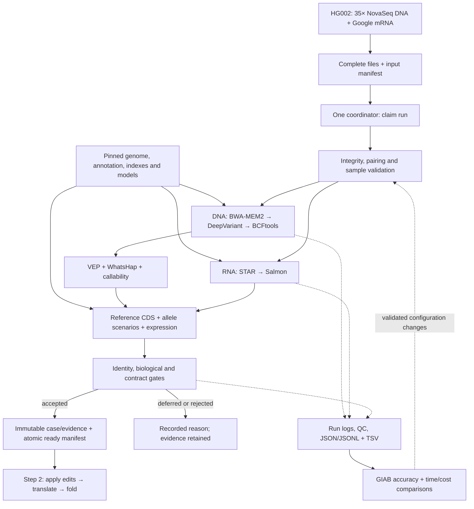

# Stage 1: human reads to the Step 2 handoff

Convert paired-end Illumina germline WGS DNA and bulk RNA into reference CDS, CDS-relative
variants, expression and explicit phase scenarios. Step 2 applies the variants, translates
and folds using the [handoff contract](architecture.md#step-1---step-2) and
[API models](../src/bespoke_bio/api.py).

Initial scope: small variants and existing autosomal, standard-code protein-coding transcripts.
Align against the full selected human reference and retain unsupported evidence with a reason.
Optimize **time and cost per validated case**, starting with one case, one coordinator and
one CPU worker. Use the pinned workflows, thin adapters, native files and retained logs.

## 1. Inputs and references

| Resource | Starting source and decision |
| --- | --- |
| DNA reads | [NIST precisionFDA Truth Challenge V2](https://data.nist.gov/od/id/mds2-2336): **`HG002.novaseq.pcr-free.35x.R1.fastq.gz`** and matching `R2`. Use the supplied approximately 35× PCR-free WGS pair unchanged. Two files and published SHA-256 checksums simplify intake and avoid custom downsampling. |
| RNA reads | [HG002 Google Illumina mRNA directory](https://ftp-trace.ncbi.nlm.nih.gov/ReferenceSamples/giab/data_RNAseq/AshkenazimTrio/HG002_NA24385_son/Google_Illumina/mRNA/reads/): **`hg002_gm24385.mrna.R1.fastq.gz`** and matching `R2`. Use the directory's `md5.in`; the [README](https://ftp-trace.ncbi.nlm.nih.gov/ReferenceSamples/giab/data_RNAseq/AshkenazimTrio/HG002_NA24385_son/Google_Illumina/README_RNAseq_Google_HG002-Ill.md) contains stale `gm24631` filenames. This is poly-A-selected bulk RNA, 2×150. Keep aliquot/passage separate from donor identity. |
| Genome and annotation | [GENCODE 50 files](https://ftp.ebi.ac.uk/pub/databases/gencode/Gencode_human/release_50/): `GRCh38.primary_assembly.genome.fa.gz`, `gencode.v50.primary_assembly.annotation.gtf.gz`, protein translations, and `MD5SUMS`. GENCODE 50 corresponds to Ensembl 116; primary assembly excludes alternate/patch sequences present in the broader bundle. |
| Variant truth | [HG002 v5.0q](https://ftp-trace.ncbi.nlm.nih.gov/ReferenceSamples/giab/release/AshkenazimTrio/HG002_NA24385_son/v5.0q/): `HG002_GRCh38_v5.0q_smvar.vcf.gz`, its index, matching `smvar.benchmark.bed`, README, and checksums. NIST now [supersedes HG002 v4.2.1](https://www.nist.gov/programs-projects/genome-bottle) with this draft benchmark. Keep truth separate from processing inputs. |

Pin these DNA files from NIST's public mirror using the [catalog metadata](https://data.nist.gov/rmm/records/ark:/88434/mds2-2336):

| Mate | Compressed bytes | SHA-256 |
| --- | ---: | --- |
| [R1](https://nist-midas.s3.amazonaws.com/pdrsrv/mds2-2336/input_fastqs/HG002.novaseq.pcr-free.35x.R1.fastq.gz) | 29,911,262,422 | `0b8578457bd4f0a0503b5f3cbafff58da84ea32cc07c7caa3c553f152ac0686e` |
| [R2](https://nist-midas.s3.amazonaws.com/pdrsrv/mds2-2336/input_fastqs/HG002.novaseq.pcr-free.35x.R2.fastq.gz) | 31,043,207,981 | `726b987b13e05c245d373a2dc6cad64b6104bd756e6ed60e6b9052b72e0965c0` |

The DNA pair totals approximately **61 GB**. Measure actual read counts and mapped coverage;
the source's nominal 35× does not guarantee coverage at every position. Preserve available
sample/library/read-group metadata. Keep other libraries in separate benchmark profiles.
Allow a download mirror only for the same pinned file and checksum, and record the URL used.
A checksum mismatch stops intake; never substitute another dataset automatically.

RNA source MD5s are `96a10e4f029805253ada8531c6ef87e9` (R1) and
`9df3298a1c919b064762bafe1963a271` (R2); sizes are 7,321,569,102 and 7,375,938,930 bytes.
Use the complete RNA library for the baseline. Record protocol and specimen IDs. For small
smoke subsets, lock the read count and seqtk seed, use matching mate seeds/order, and retain
derivation commands and hashes. Verify source checksums after transfer; compute SHA-256
when registering immutable inputs.

Bundle FASTA/`.fai`, per-contig MD5 dictionary, GTF, versioned transcript/CDS/protein records,
and indexes. Derive transcripts within the same assembly scope; validate exon order, strand,
CDS phase and translation against GENCODE proteins. Include the annotated terminal stop in
the handoff CDS. Check benchmark contigs/reference sequences; masked GRCh38 is a different
asset. Never silently strip versions or rename contigs to force a join.

MANE prioritizes transcripts; retain other isoforms. Optional gnomAD enrichment uses indexed
local sites files with artifact version, population, allele number and missingness.
[gnomAD 4.1.2](https://gnomad.broadinstitute.org/news/2026-09-gnomad-v4-1-2/) updates constraints
only; frequency data remain those of 4.1.1. Preserve common coding alleles.

## 2. Tools

Run Linux x86-64 containers on the worker. Use Python/Pydantic for the small adapter and
native libraries for indexed I/O; keep per-read processing inside established engines.
Stage 1 needs no GPU, hosted analysis API, database server or workflow control service.

| Work | Baseline | Main implementation / license |
| --- | --- | --- |
| Scheduling, resources, retries, resume | [Nextflow **26.10.2**](https://github.com/nextflow-io/nextflow/releases/tag/v26.10.2), Docker Engine; [sarek **3.10.0**](https://github.com/nf-core/sarek/tree/3.10.0), [rnaseq **3.27.0**](https://github.com/nf-core/rnaseq/tree/3.27.0) | Nextflow Apache-2.0; workflows MIT |
| Intake/QC | Workflow FastQC and MultiQC | Java/Python; GPL-3.0 |
| RNA adapter handling | Workflow [Trim Galore **2.3.0**](https://github.com/nf-core/rnaseq/blob/3.27.0/modules/nf-core/trimgalore/environment.yml) | GPL-3.0; retain dependency licenses |
| Reproducible fixture sampling | [seqtk **1.5**](https://github.com/lh3/seqtk/tree/v1.5), matching mate seeds/order | C; MIT |
| DNA mapping and preparation | Sarek BWA-MEM2 **2.3**, SAMtools/HTSlib and GATK duplicate marking; retain marked reads | C/C++/Java; MIT/BSD/Apache-2.0 components |
| Germline SNVs/short indels | Sarek DeepVariant **1.10.0**, WGS model; retain VCF **and gVCF** | Native/model computation; BSD-3-Clause |
| Normalize, index, coverage | BCFtools, SAMtools, workflow mosdepth; preserve original calls | C/Nim; BCFtools MIT or GPL depending on build; mosdepth MIT |
| Consequences | Offline Ensembl VEP **116.0**, matching **116** cache and pinned FASTA | Perl/native dependencies; Apache-2.0 |
| RNA evidence | rnaseq STAR **2.7.11b** + Salmon **2.7.0**, `star_salmon` route | C++ / Rust; MIT / BSD-3-Clause |
| Read-backed phase | [WhatsHap **2.8**](https://whatshap.readthedocs.io/en/stable/guide.html), including indels | Python/C++; MIT |
| Reference CDS extraction | [gffread **0.12.9**](https://github.com/gpertea/gffread), indexed PySAM reads and a small coordinate adapter | C++ / HTSlib-backed Python; MIT |
| Identity and accuracy checks | [Picard CrosscheckFingerprints](https://broadinstitute.github.io/picard/command-line-overview.html#CrosscheckFingerprints); [hap.py](https://github.com/Illumina/hap.py) with RTG vcfeval | Java / C++/Python/Java; MIT / BSD licenses |

Use native tool outputs, JSON manifests, JSONL events and small TSV reports for the pilot.
Defer Parquet and DuckDB until repeated queries across runs justify them; they are optional
reporting tools, not dependencies of the biological pipeline. Keep full callsets in indexed
native formats instead of building another database or copying them into JSON.

Both workflow tags require Nextflow ≥25.10.4. Lock commits,
public source URLs, container digests, models, databases and dependency licenses in
`config/stage1.lock.json`. Keep resolved runtime configs with private run artifacts.
Retain workflow-pinned dependencies and cache all run assets locally. Put the selected
workflow options in the versioned profile and save their resolved values with every run.
Missing required settings or assets stop preflight; do not select another tool or model.

Baseline preprocessing: Sarek `aligner: bwa-mem2`, `trim_fastq: false`, `split_fastq: 0` and
`skip_tools: baserecalibrator`; keep duplicate marking and its metrics enabled. RNA uses
`aligner: star_salmon`, `trimmer: trimgalore`, `skip_trimming: false` and
`save_align_intermeds: true` (`--save_align_intermeds` on the command line).
DeepVariant [recommends skipping base-quality recalibration](https://github.com/google/deepvariant/blob/r1.10/docs/deepvariant-details.md).
These are explicit pilot choices; benchmark read splitting or trimming in separate profiles.
[Sarek options](https://nf-co.re/sarek/3.10.0/parameters),
[RNA options](https://nf-co.re/rnaseq/3.27.0/parameters).

Register RNA's sorted genomic BAM/index, original transcriptome BAM, splice junctions and
Salmon outputs explicitly. rnaseq normally publishes final filtered BAMs; saving alignment
intermediates also retains earlier evidence. Check the required files before publication
and include the extra BAMs in the disk budget. [RNA outputs](https://nf-co.re/rnaseq/3.27.0/docs/output).

rnaseq 3.27.0 already pins Salmon 2.7.0. Newer releases—[Salmon 2.8.0](https://github.com/COMBINE-lab/salmon/releases/tag/v2.8.0),
[VEP 116.3](https://github.com/Ensembl/ensembl-vep/releases/tag/release/116.3),
[SAMtools](https://github.com/samtools/samtools/releases/tag/1.24)/[BCFtools 1.24](https://github.com/samtools/bcftools/releases/tag/1.24)—need upgrade benchmarks.
Include a project `LICENSE` and record code/model/data licenses and redistribution terms,
including GPL dependencies and vendor terms for optional CUDA acceleration.
Generate container dependency inventories with [Syft](https://github.com/anchore/syft), export
SPDX JSON, and review model/data terms separately. The project's license does not replace
dependency licenses; contributors must agree the project license before it is applied.

Sarek's [VEP defaults](https://nf-co.re/sarek/3.10.0/parameters)
include `--filter_common --per_gene`. Remove both, retain all transcript consequences,
request versioned transcript IDs and reference checks, and reconcile annotated records
against original calls. Restrict optional VEP plugins to the resources actually locked.

Use BWA-MEM2 for read mapping; reserve protein homology/MSA search for Step 2. Benchmark
[minibwa](https://github.com/lh3/minibwa), [fastVEP](https://github.com/Huang-lab/fastVEP) or
elPrep only at measured bottlenecks, checking reference support, biological differences and
memory cost.

## 3. Processing and validation

1. **Receive.** Replay complete FASTQ pairs, uploading the input manifest last. One coordinator
   polls for manifests and claims each case before launching work. Identify a run by case
   identity and hashes of the input manifest, reference bundle, tool lock and configuration.
   Sensor metadata accompanies files; raw-signal basecalling is outside scope.
2. **Validate intake.** Check hashes, decompression, FASTQ structure, sequence/quality lengths,
   read-pair names/counts/order, sample metadata, and supported assay. Preserve `N` and raw
   reads; reject malformed data. Use native parsers and combine scans where practical.
3. **Run branches.** DNA: map → sort/index → mark duplicates → DeepVariant VCF/gVCF →
   normalization, using the preprocessing settings above. RNA:
   Trim Galore adapter handling → STAR → Salmon; retain genomic/splice evidence and native outputs.
   Check mapping, duplication, coverage, contamination indicators, strandedness/rRNA and
   fingerprints. Mismatched or inconclusive sample identity blocks release.
4. **Annotate and phase.** Preserve assembly-qualified variant IDs, QUAL, FILTER, DP, GQ,
   allele depths, genotype, PS and original-to-normalized allele links. Test multiallelic
   genotype/AD/PL remapping. WhatsHap supplies supported phase blocks; never connect
   independent PS blocks or label a haplotype maternal/paternal without evidence.
   RNA abundance is transcript-total, not allele-specific.
5. **Resolve CDS.** Project variants through the exon map in coding orientation: VCF/CDS
   positions are 1-based; BED is 0-based half-open. Reverse-complement negative-strand
   alleles and retain valid indel anchors. VEP consequence/position alone is insufficient.
   Normalize adapter sequences to uppercase DNA (`U` → `T`); require unambiguous `ACGT`
   for released CDS. Reject REF mismatches, overlaps and unsupported boundary edits.
6. **Gate targets.** Require PASS calls and confident genotypes across the entire CDS;
   missing VCF records are not reference evidence. Configure replay thresholds for depth ≥10
   and GQ ≥20 throughout, using gVCF block minima and per-base coverage, never block averages.
   Record uncertainty. Defer unresolved splicing/phase, partial CDS, selenoproteins, premature
   stops and frameshift/start-loss/stop-loss cases under the initial complete-protein policy.
7. **Publish.** Validate payload, counts, hashes and index access. Write immutable outputs
   under a unique attempt directory, then atomically create the ready manifest. Readers
   consume ready manifests only. Never overwrite published artifacts. Account for every
   accepted/deferred/rejected candidate; an empty selection cannot be sent to Step 2.

Malformed or incompatible case data stops the run. Unsupported or uncertain transcripts
receive a recorded deferral reason. Missing phase or coverage never becomes a reference
allele, and retries never relax quality thresholds.

[SAMtools quickcheck](https://www.htslib.org/doc/samtools-quickcheck.html) skips file interiors;
also require full native decoding, sort/index checks and read-count reconciliation. Expression
must be finite/nonnegative; retain fractional Salmon counts.

Keep cutoffs in a versioned **pilot QC profile**, separate from validation code:

| Gate | Initial rule |
| --- | --- |
| Integrity and reference | Zero hash/pair/REF mismatches; exact annotation joins; no invalid or non-finite values |
| DNA/RNA identity | Matching sample fingerprints with normal-normal LOD >5; otherwise hold the case. Pin a compatible haplotype map and test a known mismatch control. |
| RNA strandedness | Start with `auto`; retain rnaseq's 0.8 stranded / 0.1 unstranded-difference thresholds. Require agreement with protocol and RSeQC; hold undetermined/conflicting cases. |
| Released CDS | Full CDS callability under the depth/GQ policy, supported phase, validated start/terminal stop and exact expected translation; all candidates have a disposition |
| Mapping, duplication, rRNA | Report distributions and investigate outliers; calibrate assay-specific limits from full runs rather than treating workflow survival thresholds as quality standards |

The LOD/depth/GQ values are conservative pilot choices, not universal assay standards.
[Picard LOD semantics](https://gatk.broadinstitute.org/hc/en-us/articles/4418062821531-CrosscheckFingerprints-Picard);
[rnaseq strandedness](https://nf-co.re/rnaseq/3.27.0/docs/usage).

## 4. Step 2 handoff and formats

Produce **`case.json`, `manifest.json` and indexed evidence**. Only `case.json` goes to
`POST /v1/build?folding_backend=...`, which runs the full Step 2 pipeline and rejects unknown
input fields. Companion evidence records schema/contract identity, reference hashes, genomic
coordinates, callability, sample identities, QUAL/GQ/DP, expression semantics, tool versions
and unsigned artifact URIs.

Use JSON Schema/Pydantic with `schema_version: "1.0.0"`, requiring `run_id`, `case_id`,
`case_sha256`, reference/config hashes, artifact roles/locations/sizes/hashes, validation
results and disposition counts. Lock the Step 2 commit and generated request-schema hash.
Validate it before submission. Link the input hash and manifest to the returned Step 2
`bundle_id` in the run catalog; the API accepts the case payload alone.

Record the submission before calling Step 2. Each POST starts a new bundle, so a timeout
after sending the request means **outcome unknown**. Hold the submission and reconcile it
with server logs/results before another attempt. Automatic resubmission requires a Step 2
idempotency contract that returns the same job for the same request; a payload hash alone
does not provide this guarantee.

Each transcript contains **unmodified reference CDS**, versioned gene/transcript IDs,
expression and edits for one explicit haplotype/scenario. Step 2 applies edits once, in
original CDS coordinates. Map `quality` to FILTER and `raw_count` to Salmon's fractional
estimate, documenting those semantics. API schema validation does not verify GENCODE identity.

Emit both supported alleles, including a no-edit reference scenario when warranted. One
unphased heterozygous site produces two unordered scenarios; multiple unresolved sites/blocks
defer the transcript. Never combine all ALTs or invent phase. Retain common and rare alleles.

[Read-backed phasing](https://whatshap.readthedocs.io/en/stable/guide.html) needs reads that
connect heterozygous sites. Short reads can leave disconnected blocks, so conservative
deferral may limit the number of usable transcripts. Before the 10-target cap, report the
fraction of in-scope expressed transcripts passing all gates, with separate counts for
phase, coverage and other deferrals. Measure this yield before optimizing runtime; keep
phase blocks and evidence so deferred transcripts can be revisited without guessing phase.

Use a configurable integration-test batch of up to **10** callable, complete autosomal
transcripts with `TPM > 0`, preferring MANE and variant-bearing examples deterministically.
Preserve all evidence and exclusion reasons. Step 2 folds every supplied unique protein.

Step 2 searches external RCSB/AlphaFold services; Boltz also requires an MSA service.
An entirely local deployment needs a separate Step 2 lookup/MSA policy. Translation preflight
uses `translate_case` locally without invoking structure lookup or folding.
Require Step 2 to retain every lookup/folding attempt: source, outcome, duration and error.
Keep **no matching structure** separate from **lookup failed**, even when a later attempt
succeeds. Pilot policy: record lookup failures, try the next lookup, then use the selected
folding backend for unresolved sequences. Never switch folding models automatically.

| Artifact | Format |
| --- | --- |
| Received reads | Original paired `FASTQ.gz` |
| Active alignment / archive | Sorted indexed BAM / lossless CRAM + CRAI + exact FASTA |
| Variants and reference confidence | Native gVCF; BCF where compatible; BGZF VCF + CSI/TBI for interchange |
| Coverage/callability, annotation | BED with coordinate convention; native VEP output |
| RNA | Sorted genomic BAM/index, transcriptome BAM, splice junctions, Salmon `quant.sf` and metadata |
| Derived reports and run records | Small TSV reports, JSON manifests and JSONL events; define field types/missing values and retain source IDs |
| Handoff and readiness | Existing-schema `case.json`; versioned `manifest.json`, QC and provenance |

Keep the Stage 1 interface as JSON plus artifact references. DeepVariant already uses
[TFRecord/Protobuf internally](https://github.com/google/deepvariant/blob/r1.10/docs/deepvariant-details.md);
leave those formats inside the engine. Another serialization layer does not accelerate its computation.

## 5. Storage and performance

Separate immutable inputs/references, durable results and disposable scratch. Stage 1 tools
run as jobs. Use SSD paths for sorting and random access. Stage inputs once per worker and
identify assets by hash/release and runs by ID.
Preserve both Nextflow metadata and required work outputs for resume; test restore before
cleaning work. Deployment sizing, access, budgets and retention belong to private runtime configuration.

On the first single-host deployment, use an OS file lock per run and one coordinator.
Hold the claim while its jobs run; duplicate arrivals report the existing run. After a crash,
confirm earlier jobs have stopped before resuming. Build reference indexes before starting
cases and share them read-only. Separate attempts have separate output/log paths.

Allow at most three download attempts total, retrying transient errors with bounded backoff.
Workflow tasks stop on failure unless the profile allows a known transient error and caps its attempts.
Keep failed-attempt logs and resume through Nextflow after recovery. Validation failures
require corrected inputs/configuration. [Nextflow's default file cache](https://docs.seqera.io/nextflow/cache-and-resume)
uses path, size and modification time. Compute/verify SHA-256 when registering inputs,
after transfer/restore and when publishing new outputs. Ordinary resume reuses those checks
for unchanged files in trusted read-only storage; do not deep-hash every FASTQ at every task.
Recheck suspected changes and invalidate affected cached work. A cache hit is not proof of integrity.

Measure one complete case before tuning concurrency. Record peak RAM and scratch by task;
include indexes, inputs, overlapping intermediates and outputs in the space budget. Reserve
headroom for the host and coordinator. Nextflow's local executor schedules requested CPU/RAM;
it does not itself contain an overrunning process. Set each task's `cpus` and `memory`, and
use `executor.$local.cpus` / `executor.$local.memory` for each launch's scheduling budget.
In 26.10, unscoped executor budgets also apply to grid executors. Enable Docker and
`docker.cpuLimits = true` for hard CPU quotas; verify Docker/cgroups enforce the requested
memory limit too. Inspect effective container limits in the smoke run; CPU shares alone
are not a hard cap. [Executor limits](https://docs.seqera.io/nextflow/reference/config/executor),
[Docker CPU limits](https://docs.seqera.io/nextflow/reference/config/docker),
[container resource limits](https://docs.docker.com/engine/containers/resource_constraints/).

Monitor free bytes and inodes on work/scratch filesystems independently of Nextflow.
Stop the run before the configured headroom floor is crossed; CPU/RAM cgroups do not cap
those mounted disks. Test shutdown and record the failure without publishing readiness.
Repeat uncached executions separately from cache/resume checks; compare latency, throughput
and cost per validated case. Reject speed gains achieved by silently reducing evidence scope.
Fewer source files simplify intake; 35× reads may take longer to process than 30× reads.
Compare processing configurations at the same coverage and evidence scope.

Performance rules:

- Profile BWA-MEM2 alignment, sorting/compression, DeepVariant's three stages and STAR's
  peak memory first. Record time, CPU, RAM and I/O per stage before changing tools or formats.
- Reuse the prebuilt reference bundle keyed by content and tool version.
- Give concurrent DNA/RNA launches separate budgets within the host's global limits.
  Separate Nextflow launches do not coordinate their resource limits.
  Count aligner, sorter and compression threads together; SAMtools sort memory is per thread.
- Use workflow-supported lane/interval scattering and correct gather steps. Stage once per
  worker, bound concurrency by RAM and scratch, and join samples/artifacts by explicit IDs,
  never arrival order.
- Keep FASTQ compressed; use supported pipes and BCF streams between adjacent tools.
  Avoid repeated gzip/text conversions and per-transcript genome scans; retain required
  sort/index outputs and durable checkpoints. Add shared memory or custom zero-copy code
  only when profiling identifies an avoidable copy as a significant bottleneck.
- Use indexed native readers and reuse transcript lookup tables. Avoid per-transcript
  genome scans or a custom query engine merely to replace an optional analytical tool.

## 6. Telemetry and CI

Retain Nextflow `-with-trace`, `-with-report`, `-with-timeline`, logs/stdout/stderr/exit codes,
resolved config, versions and MultiQC per attempt. Adapter JSONL events contain UTC time,
run/task/attempt ID, stage, status, duration and error category. Keep the original tool error,
exit code and log path; later success must not erase earlier failures. Keep one manifest
and event log per attempt, plus a small TSV summary. [Nextflow reports](https://docs.seqera.io/nextflow/reports).

Measure transfer bytes/time, queue/runtime, CPU, peak RAM, disk I/O/scratch, retries/cache
hits, biological QC, phase/callability, target disposition and variant accuracy. Supplement
traces with host `pidstat`/`iostat`/disk sampling. Separate cold setup, warm processing and
resume timings; include VM/disk/storage/transfer/retry costs.

Start with these files. Add queues, analytical servers, custom scheduling
or [OpenTelemetry](https://opentelemetry.io/docs/what-is-opentelemetry/) only for a measured need.
If metrics services are added, use bounded stage/tool/status labels; keep IDs/hashes in private
logs and sequences out of traces.

PR CI runs Ruff, pytest, contract/fixture tests and Gitleaks without worker/data access.
Pin Actions by commit SHA. Publish reviewed public-fixture reports only; redact authenticated
URLs and environment dumps. Keep provisioning, addresses, identities, credentials and resolved
runtime configuration outside Git. Public locks contain public dataset URLs; private artifact
locations remain in runtime manifests.

## 7. Layout and implementation order

```text
config/stage1.lock.json          # public sources, tools, models, licenses and hashes
config/stage1.yaml               # portable resource defaults, QC policy, target limit
workflows/stage1/                # pinned upstream launch configs; adapter tasks
src/bespoke_bio/stage1/          # intake, references, evidence, cds, handoff, cli
tests/stage1/                   # contract, biology, failure and replay tests
tests/fixtures/stage1/           # tiny public/synthetic fixtures + provenance
.github/workflows/              # unprivileged CI only
```

Use small typed functions, explicit subprocess arguments and bounded native I/O. Separate
scheduling from biology. Reuse Step 2 models, with independent expected sequences for tests.
Keep Stage 1 out of `api.py`; configure upstream workflows rather than forking them.

1. **Lock and contract:** freeze files, reference compatibility, containers/licenses,
   preprocessing settings, retry policy, companion schema and Step 2 contract tests.
2. **Intake replay:** test interrupted transfer, wrong hash, broken FASTQ/pairs, duplicate
   claims, crash recovery, wrong donor/reference, corrupted cached output, failed pipe and
   atomic publication. Readers must never accept an incomplete attempt.
3. **Smoke:** run upstream `test,docker`, then bounded human data against the full reference.
   Exercise the actual DeepVariant/VEP and STAR/Salmon configuration. Verify CPU/memory
   limits, disk-headroom shutdown, RNA evidence publication and resume without repeated input hashing.
4. **Full case:** run the supplied approximately 35× HG002 DNA pair + selected RNA. Follow
   v5.0q's hap.py/vcfeval instructions, sex/ploidy settings and GIAB v3.6 stratifications.
   Report SNP/indel precision, recall/F1, counts and uncertainty across benchmark, coding and difficult regions; do not
   shrink the evaluation BED to the pipeline's callable regions. Report RNA QC and phase completeness.
5. **Handoff:** independently verify every released reference/alternate sequence. Test
   schema/hashes, negative strands, exon boundaries, indels, multiallelic sites, common
   alleles, unphased combinations, missing coverage, fractional
   counts, non-finite expression, missing terminal stops and premature stops. Require independently
   expected sequences, not just agreement with Step 2. Preflight with `TranslateRequest.model_validate`
   and `translate_case`; `/v1/build` also executes folding, which belongs to Step 2.
   Test a lost submission response and lookup failure followed by success: no automatic
   duplicate submission, and earlier errors remain visible.
6. **Qualify, then optimize:** review the first baseline against matching upstream evaluations;
   freeze its inputs, evaluation regions and results before testing alternatives. Start with
   zero tolerated precision/recall regression on aggregate and coding benchmarks, with
   difficult-region changes reviewed individually. Record callable/released-target counts
   so increased deferral cannot masquerade as improvement. Change one component at a time.

HG002 is an integration/regression dataset: [DeepVariant 1.10 WGS training](https://github.com/google/deepvariant/blob/r1.10/docs/deepvariant-details-training-data.md)
includes HG002. Reproduce the upstream HG003 DNA evaluation as an additional check; it is
absent from that WGS training list but related to HG002. Add an unrelated donor and another
library/platform before broader claims. Freeze scientific acceptance criteria before evaluating
that holdout. Absolute accuracy targets must match assay, reference and benchmark scope;
do not import a generic percentage or use DNA truth to claim RNA expression accuracy.

For RNA validation, add [UNC GM24385 replicates](https://ftp-trace.ncbi.nlm.nih.gov/ReferenceSamples/giab/data_RNAseq/AshkenazimTrio/HG002_NA24385_son/UNC_Illumina/)
for reproducibility and a bounded Illumina [SEQC GSE47774](https://www.ncbi.nlm.nih.gov/geo/query/acc.cgi?acc=GSE47774)
profile with known mixtures/ERCC controls for relative-expression checks. Lock its files
and control sequences separately. The [published provisional HG002 RNA benchmark](https://pmc.ncbi.nlm.nih.gov/articles/PMC12081282/)
includes the selected Google library, so it is not an independent check of that input.
Neither these controls nor one cell-line library establishes every human isoform's abundance.

Scale by adding independently scheduled cases with immutable inputs and atomic publication.
Use per-task resource limits, bounded queues and idempotent retries; keep biology independent
of worker count. Add services only when measured concurrency or query load requires them.


