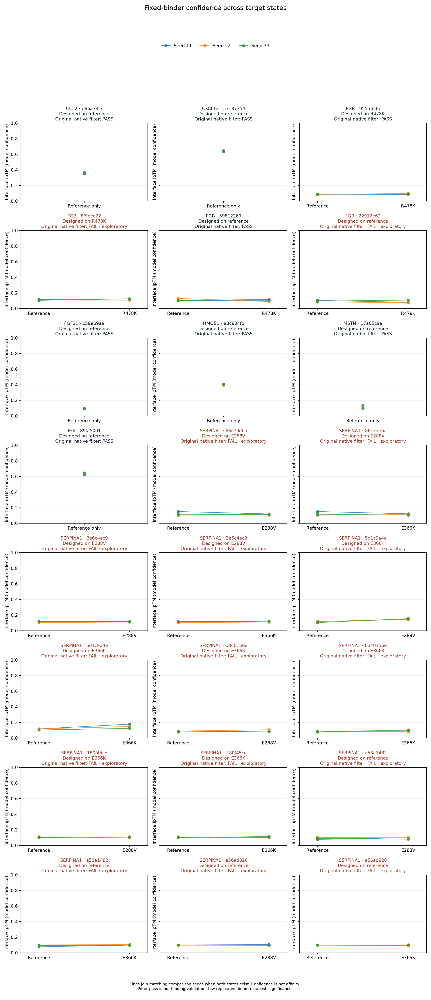
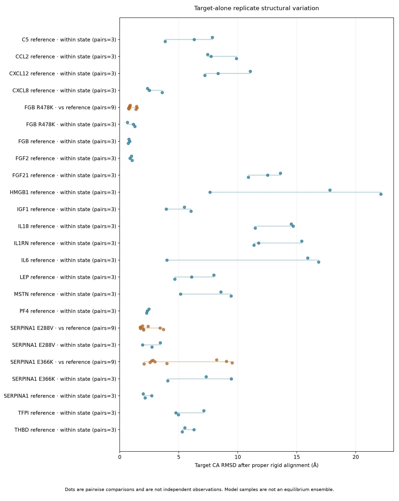
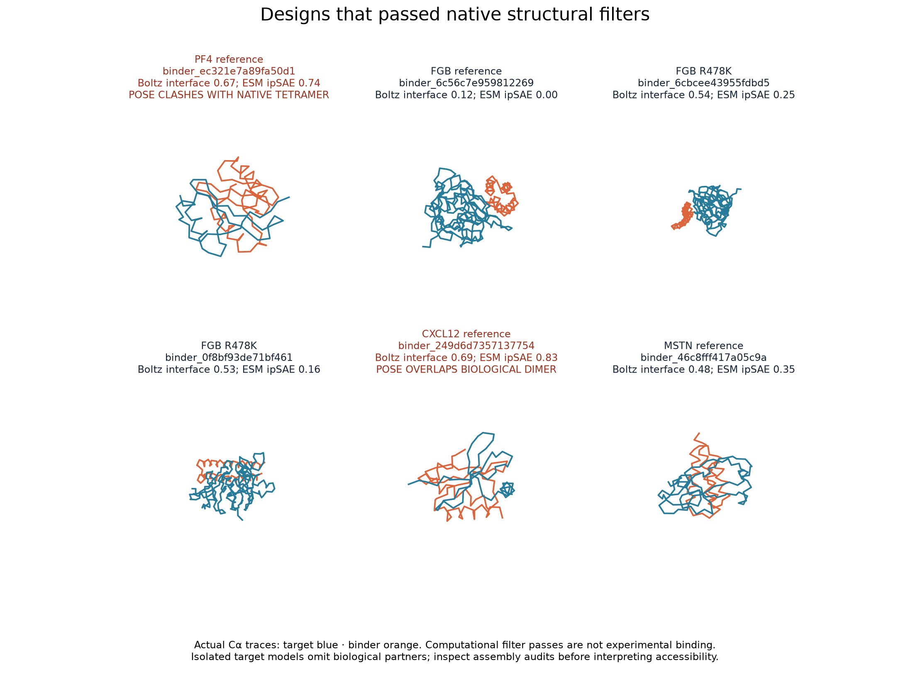
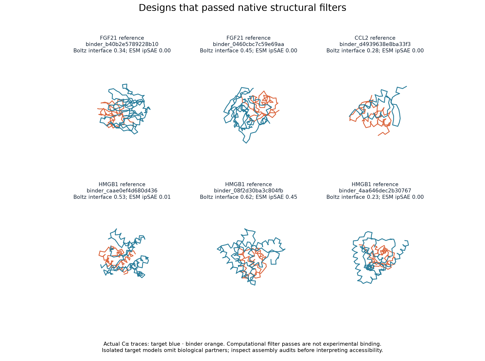
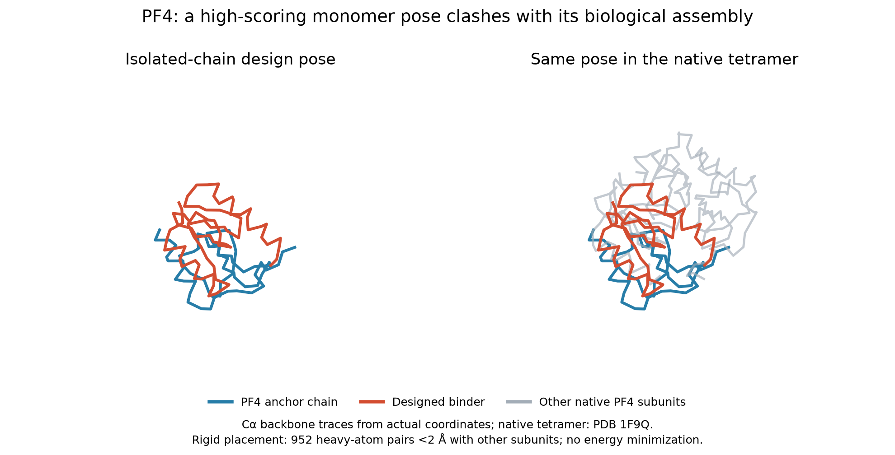

# Expanded protein binder research panel

**Completed export of available outputs.**

21 target states; **104 actual generated candidates**; 12 native filter passes, 92 failures, 0 unknown. Counts use downloaded native bundles.

| Target | State | Generation status | Candidates | Pass | Fail | Unknown |
| --- | --- | --- | ---: | ---: | ---: | ---: |
| IGF1 | reference | completed | 4 | 0 | 4 | 0 |
| PF4 | reference | completed | 4 | 1 | 3 | 0 |
| SERPINA1 | reference | completed | 8 | 0 | 8 | 0 |
| SERPINA1 | E288V | completed | 8 | 0 | 8 | 0 |
| SERPINA1 | E366K | completed | 8 | 0 | 8 | 0 |
| FGB | reference | completed | 8 | 1 | 7 | 0 |
| FGB | R478K | completed | 8 | 2 | 6 | 0 |
| FGF2 | reference | completed | 4 | 0 | 4 | 0 |
| IL1RN | reference | completed | 4 | 0 | 4 | 0 |
| CXCL12 | reference | completed | 4 | 1 | 3 | 0 |
| TFPI | reference | completed | 4 | 0 | 4 | 0 |
| IL6 | reference | completed | 4 | 0 | 4 | 0 |
| MSTN | reference | completed | 4 | 1 | 3 | 0 |
| THBD | reference | completed | 4 | 0 | 4 | 0 |
| FGF21 | reference | completed | 4 | 2 | 2 | 0 |
| CCL2 | reference | completed | 4 | 1 | 3 | 0 |
| CXCL8 | reference | completed | 4 | 0 | 4 | 0 |
| IL18 | reference | completed | 4 | 0 | 4 | 0 |
| LEP | reference | completed | 4 | 0 | 4 | 0 |
| HMGB1 | reference | completed | 4 | 3 | 1 | 0 |
| C5 | reference | completed | 4 | 0 | 4 | 0 |

[Read the completed findings and limitations](FINDINGS.md).

## What these results mean

- Native structural filters are computational gates, not proof of binding or therapeutic activity.
- Interface ipTM and ESMFold2 ipSAE are confidence metrics, not affinity measurements.
- Fixed-binder reference/variant comparisons are exploratory; three model samples do not establish significance, selectivity, or an equilibrium ensemble.
- Generation seeds were uncontrolled. Comparison Lightning/Torch seeds were 11/22/33; native feature randomness remains nondeterministic.
- Experimental inputs use the exact modeled spans in inputs.json, including terminal truncations. Oligomers, modifications and cofactors may be omitted.
- SERPINA1 E288V/E366K are controlled substitutions on canonical background, not full phased S/Z haplotypes.

Comparison progress: 168/168 planned predictions reported.

**PF4 assembly caveat:** the monomer lead retains its native filter pass, but its rigid pose clashes severely with the intact experimental tetramer. It is not an assembly-compatible lead. See summary.json and the assembly image.

## Files

- [Actual target sources and biological context](SOURCES.md)
- [Input sequences and construct metadata](inputs.json)
- [Target FASTA](targets.fasta)
- [Binder FASTA](binders.fasta)
- [Candidate scores](candidates.csv)
- [Repeated comparison scores](comparison_scores.json)
- [Machine-readable summary](summary.json)
- [Pinned model revision and protocol](protocol.json)
- [Assembly audit summary](assembly_audits.md)
- [Assembly geometry data](assembly_audits.json)

